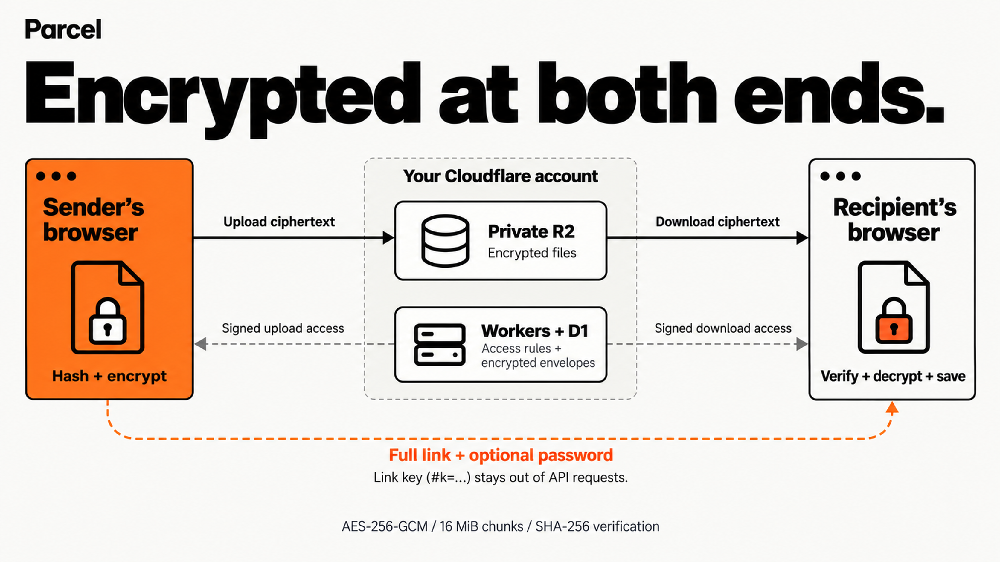
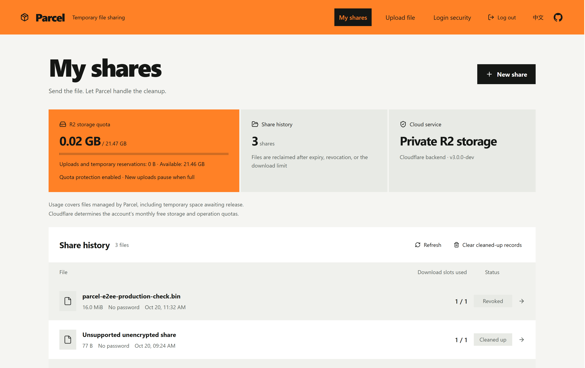

<h1 align="center">Parcel</h1>

<p align="center"><strong>Upload. Share. Disappear.</strong></p>
<p align="center">End-to-end encrypted file sharing on your own Cloudflare account.<br>Encrypt in the browser. Share a link. Let expired files clean themselves up.</p>

<p align="center"><a href="README.md">简体中文</a> · <strong>English</strong></p>

<p align="center">
  <a href="https://github.com/hyphy-void/Parcel/actions/workflows/ci.yml"></a>
  <a href="LICENSE"></a>
  <a href="docs/e2ee-protocol.md"></a>
</p>

<p align="center">
  <a href="https://deploy.workers.cloudflare.com/?url=https%3A%2F%2Fgithub.com%2Fhyphy-void%2FParcel"></a>
</p>

<p align="center">
  <a href="https://parcelwiki.pages.dev/">English guide</a> ·
  <a href="https://parcelwiki.pages.dev/zh">中文教程</a> ·
  <a href="#deploy-your-own">Deploy your own</a> ·
  <a href="docs/e2ee-protocol.md">Encryption protocol</a>
</p>

---

Send a large file, hand over a link, and decide how long it stays available. Parcel gives you a temporary file drop with browser-side encryption, resumable transfers, and automatic cleanup—all running in your own Cloudflare account.

The sender's browser encrypts the file before it leaves the device. Private R2 stores ciphertext. The recipient's browser decrypts and saves it locally. File keys and original filenames stay inside an encrypted envelope that the server cannot unlock.

## Architecture



## In action

### Create a share

Choose a file and set its expiry, download limit, and optional password before uploading.


### Manage your shares

Check storage usage and share history, open share details, and revoke access when needed.



## Why Parcel?

- **Encrypt before upload.** Each file gets a random 256-bit key. AES-256-GCM authenticates every chunk; a full-file SHA-256 check verifies the saved content.
- **Share with an expiry date.** Set a share password, choose a lifetime, and cap download admissions—or allow unlimited downloads. Revoke a share whenever you need to.
- **Pick up where you left off.** Resume uploads after reselecting and verifying the original file. Downloads reuse complete cached chunks after a refresh.
- **Move large files in chunks.** Streaming encryption and saving keep memory use bounded. The default per-file limit is **8 GiB**, configurable for your deployment.
- **Keep administration protected.** Administrator password + TOTP, QR or manual authenticator enrollment, and eight recovery codes. Share passwords are managed separately.
- **Run it in your account.** Workers serves the UI and API, D1 tracks state, and private R2 stores encrypted files. Scheduled cleanup reclaims storage after shares expire, are revoked, or reach their download limit.

## From file to link

1. **Upload.** Sign in, select a file, and choose its password, expiry, and download limit. Parcel hashes the file, encrypts it in chunks, and uploads the ciphertext directly to R2.
2. **Share.** Copy the complete link, including `#k=…`. Send the optional password separately.
3. **Receive.** The recipient opens the link, enters the password if needed, and receives encrypted chunks. Once reception finishes, **Save decrypted file** verifies, decrypts, and streams the file to disk.
4. **Manage.** Revoke access or change the password from your dashboard. Password changes rewrap the key envelope without uploading the file again; the managing browser needs the local share key or an imported backup.

> **Keep the full link and back up your share keys.** Export an encrypted key backup before clearing site data or switching devices. Administrator login cannot recover missing file keys.

## How it works

Files are encrypted in **16 MiB chunks**. Filenames, media types, modification times, plaintext hashes, and file keys are sealed in an authenticated metadata envelope. The `#k=…` fragment carries random link material; URL fragments are not sent with HTTP requests, and Parcel keeps it out of its API calls. An optional password adds Argon2id-based protection to the envelope.

The service can see file sizes, share IDs, access rules, download counts, and request metadata. Encryption relies on the page code you load, your browser, and your device. For the format, key derivation, trust boundaries, and test coverage, read the [encryption protocol](docs/e2ee-protocol.md).

## Deploy your own

You need a Cloudflare account with Workers, D1, and R2 enabled, plus Node.js 24 and Bash for the local setup commands. On Windows, use Git Bash or WSL.

The [illustrated guide](https://parcelwiki.pages.dev/) walks through every dashboard step and includes a [configuration generator](https://parcelwiki.pages.dev/#config) for runtime variables and R2 CORS.

### 1. Create the application

[](https://deploy.workers.cloudflare.com/?url=https%3A%2F%2Fgithub.com%2Fhyphy-void%2FParcel)

Use Node **24**, repository root `/`, build command `npm run build`, and deploy command `npm run deploy`. The deployment applies D1 migrations. Keep **`ACTIVE=false`** during setup.

### 2. Connect your storage and URL

Use the [configuration generator](https://parcelwiki.pages.dev/#config) to set `PUBLIC_URL`, the R2 endpoint, and bucket name. Apply its CORS policy to the private bucket. Keep **`ADMIN_AUTH=totp`** for administrator password + authenticator login.

Save these long-lived Worker Secrets:

| Secret | Value |
| --- | --- |
| `SESSION_SECRET` | An independent random 64-character hexadecimal value. Preserve it across deployments. |
| `R2_ACCESS_KEY_ID` | An R2 S3 credential scoped to the application's bucket. |
| `R2_SECRET_ACCESS_KEY` | The matching R2 S3 secret, with Object Read & Write access. |

### 3. Enroll the administrator

Generate a temporary setup token locally:

```bash
git clone https://github.com/hyphy-void/Parcel.git
cd Parcel
npm run admin:setup-token
```

Copy the contents of the ignored `.parcel-v3/admin-setup-token.txt` file into a temporary Worker Secret named `ADMIN_SETUP_TOKEN`. Open `/login`, set an administrator password of at least 12 characters, and enroll your authenticator by QR code or manual entry. Confirm with a six-digit TOTP code.

### 4. Save recovery codes and activate

Store the **eight recovery codes** separately, then remove `ADMIN_SETUP_TOKEN`. Verify password + TOTP login in a new window. Set **`ACTIVE=true`**, deploy, and test an encrypted upload, a decrypted download, and revocation. Maintenance mode permits administrator enrollment and login while file transfers remain disabled.

The template defaults to a **9 GB application storage quota** and an **8 GiB per-file limit**. These are application settings; Cloudflare account allowances and billing are separate.

Prefer the CLI? Follow the [deployment reference](docs/v3-deployment.md) to prepare a local configuration, then use `npm run deploy:bootstrap -- --config .parcel-v3/deploy.json`. Complete administrator enrollment in maintenance mode before deploying with `--activate`.

## Know before you send

| Topic | What to expect |
| --- | --- |
| **Local disk space** | Receiving stages ciphertext in browser storage before saving the decrypted file. Allow roughly twice the file size, plus headroom. Browser quotas, private browsing, and available disk space affect capacity. Keep the page open while saving. |
| **Transfer recovery** | Keep site data to retain upload keys and cached download chunks. Upload recovery also requires the original file; expired sessions or evicted browser data may require a new transfer. |
| **Download limits** | Counts track admitted transfers, rather than successful saves or unique people. Retries, resumes, and URL renewals within the same valid session do not consume another admission. Interrupted transfers do not refund one. |
| **Revocation and expiry** | Stop new download admissions. Previously issued URLs remain usable until they expire; files, keys, and ciphertext already obtained cannot be recalled. Cleanup waits for outstanding access before deleting objects. |
| **Key backups** | Export local share keys as encrypted JSON with a separate 12–256 UTF-8-byte passphrase. Keep the backup and passphrase secure; losing all usable keys, full links, and backups makes server-side recovery impossible. |

## Updating an existing instance

For a configured production Worker with a verified custom domain, use the production commands after preparing `PARCEL_WORKER_BUILD_CONFIG` as described in the [update instructions](docs/v3-deployment.md):

```bash
npm run build:production
npm run deploy:production
```

The deployment applies pending D1 migrations before publishing the Worker and retains existing runtime variables, long-lived Secrets, and administrator enrollment. Keep compatible Worker versions and D1/R2 backups for recovery.

Upgrading from an older, unencrypted deployment? Reupload original files to create encrypted shares. Existing migrations do not encrypt or erase old objects. Encrypted shares require a compatible Worker and cannot be served by the independent Go application.

## Development

The Cloudflare deployment uses React + TypeScript, Workers, D1, and private R2. From the repository root, with Node.js 24 and Bash:

```bash
npm run build
npm run test:crypto
npm run test:v3
npm --prefix cloudflare run test:browser:v3
PARCEL_LOGIN_WEB_DIR="$PWD/dist/v3-web" node --test web/tests/login-response.mjs
npm run test:e2ee:https
```

Browser tests require installed Playwright browsers. The real HTTPS suite runs on Linux and needs OpenSSL and NSS `certutil`; see [test prerequisites and optional large-file acceptance](docs/e2ee-protocol.md#acceptance). Verify R2 CORS, signed requests, and transfers on your deployed instance as well.

The repository also retains an independent Go/SQLite application using its earlier protocol. Its build and test instructions are in the [operations guide](docs/operations.md); the Cloudflare deployment's TOTP and file encryption features apply to the Worker application described here.

## Documentation

| Start here | What's inside |
| --- | --- |
| [English setup guide](https://parcelwiki.pages.dev/) · [中文教程](https://parcelwiki.pages.dev/zh) | Illustrated deployment, configuration generator, and troubleshooting. |
| [Deployment reference](docs/v3-deployment.md) | Secrets, CORS, administrator recovery, updates, and backups. |
| [Encryption protocol](docs/e2ee-protocol.md) | File format, key derivation, trust model, and acceptance tests. |
| [Acceptance status](docs/v3-plan.md) | Verified behavior and the scope of each check. |
| [Security policy](SECURITY.md) | How to report vulnerabilities privately. |

## Contributing

Issues and pull requests are welcome. Describe the behavior you want to change, include relevant validation, and add screenshots for UI changes. Keep credentials, full share links, private files, and database snapshots out of public reports.

## License

[MIT](LICENSE). Deploy it, adapt it, make it yours.
