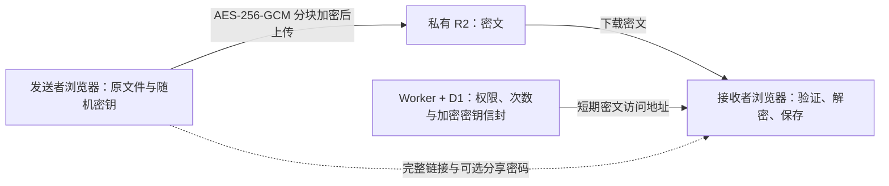

# Parcel

**Upload. Share. Disappear.**

自托管的临时文件中转站。当前 Cloudflare V3 在发送者浏览器加密文件，私有 R2 保存密文，接收者在浏览器解密并流式保存。分享可设置密码、有效期和下载次数，失效后自动清理。

[](https://deploy.workers.cloudflare.com/?url=https%3A%2F%2Fgithub.com%2Fhyphy-void%2FParcel)

当前部署流程统一使用 **Workers + D1 + 私有 R2、管理员密码 + TOTP**。支持认证器扫码或手动绑定、一次性恢复码和更换认证器。管理员密码与分享密码分别管理。

- [中英图文教程](https://parcelwiki.pages.dev/zh)
- [部署、更新与恢复](docs/v3-deployment.md)
- [端到端加密协议](docs/e2ee-protocol.md)
- [验收状态与范围](docs/v3-plan.md)

## 部署与首次登录

1. 点击部署按钮，创建自己的 Worker、D1 和私有 R2。使用 Node 24、根目录 `/`，构建命令 `npm run build`，部署命令 `npm run deploy`。脚本应用 D1 迁移，首次保持 `ACTIVE=false`。
2. 按[配置工具](https://parcelwiki.pages.dev/zh#config)填写 `PUBLIC_URL`、**`ADMIN_AUTH=totp`**、R2 地址与桶名。此认证变量必须明确设置，更新代码不会自动补充控制台变量。新模板默认应用配额为 9 GB、单文件上限为 8 GiB；账户免费额度与账单另行计算。
3. 保存三项长期 Secret：`SESSION_SECRET`、`R2_ACCESS_KEY_ID`、`R2_SECRET_ACCESS_KEY`，配置 R2 CORS。`SESSION_SECRET` 是独立的 64 位十六进制随机值，后续部署保持不变。
4. 本机克隆仓库，执行 `npm run admin:setup-token`，把忽略文件 `.parcel-v3/admin-setup-token.txt` 的内容保存为临时 Secret `ADMIN_SETUP_TOKEN`。打开应用 `/login`，设置至少 12 位管理员密码，扫码或手动绑定 TOTP，输入 6 位动态码确认。
5. 单独保存 8 个恢复码，移除 `ADMIN_SETUP_TOKEN`。日常使用密码和认证器动态码；认证器丢失时，用密码与一个未使用的恢复码重新绑定。完成加密上传、解密下载和撤销验收后，再设 `ACTIVE=true` 并部署。

新实例按按钮流程准备资源；已有正式实例使用 `npm run build:production` / `npm run deploy:production` 更新。变量、CORS、备份及恢复的完整步骤见[部署文档](docs/v3-deployment.md)。

## 使用加密分享

1. **上传。** 登录后选择单个文件，设置可选分享密码、有效期及下载上限，也可选择不限次数。浏览器先计算完整 SHA-256，再逐块加密上传。暂停或刷新后保留网站数据，重选原文件并核对完整哈希，再继续缺失块。
2. **分享与备份。** 复制包含 **`#k=…`** 的完整链接，可选密码分开发送。创建者保留链接，并在清理网站数据或换设备前，通过“备份 / 导入本机分享密钥”导出加密 JSON，使用独立的 12–256 UTF-8 字节口令。
3. **接收与保存。** 接收者在本机用完整链接和可选密码解包密钥，验证密文并暂存 IndexedDB。接收完成后点“保存解密文件”，逐块验证、解密、流式写盘并核对完整 SHA-256。刷新可从完整缓存块继续；确认保存后可清理本机缓存。
4. **管理。** 修改分享密码只重包密钥信封，不重传文件；操作浏览器须持有本机分享密钥或导入备份。撤销、到期或次数耗尽后不再发放新下载资格。已取得的明文、密钥和密文副本无法收回。

大文件按块处理，内存占用不会随总大小增长。本机通常需同时容纳密文缓存与最终文件，约两倍文件大小并预留余量。浏览器配额、无痕模式、磁盘空间、下载权限和缓存清理会影响可用容量；保存期间保持页面打开。

下载次数统计获准传输的资格，不是成功保存次数或独立人数。同一有效会话的重试、续传和签名地址续签不重复扣次；网络中断不退还已消耗的资格。

## 文件怎样被保护



每份文件使用独立随机 256 位密钥，按 16 MiB 原文分块执行 AES-256-GCM。每块增加 12 字节随机 nonce 和 16 字节认证标签；空文件也有一个 28 字节认证块。文件名、媒体类型、修改时间、原文 SHA-256 和文件密钥保存在加密信封中，云端不持有明文文件密钥。

链接的 `#k=…` 保存随机 32 字节链接材料，片段不随 HTTP 请求发送，也不进入 Parcel API。无密码时，由链接材料经 HKDF 派生信封密钥；有密码时，再加入独立盐的 Argon2id 结果。另一份不同盐的密码凭据仅用于服务端在线授权，不能代替解密密钥。布局、认证范围和参数见[协议文档](docs/e2ee-protocol.md)。

服务端仍可见大小、分享 ID、有效期、次数与请求元信息。机制信任实际加载的网页代码、浏览器和设备；恶意网页更新、扩展或已控制的终端仍可能读取密钥。拥有完整链接与信封的人可以离线尝试分享密码，因此应使用强密码。

**管理员登录与 `SESSION_SECRET` 不能找回文件密钥。** 本机密钥、完整链接和可用备份全部丢失后，服务器无法恢复文件。`SESSION_SECRET` 保护管理员认证、会话和在线密码凭据，不用于生成文件密钥。

## 更新与旧分享

正式 Worker 的生产部署先应用未完成的 D1 迁移，再发布 Worker，保留现有运行时变量、Secrets、D1 与 R2。资源标识、部署权限及失败恢复见[正式更新说明](docs/v3-deployment.md#正式-worker-的-git-自动部署)。

旧版未加密 V3 分享不兼容，需保留原文件后重新上传，生成新的加密链接。`0004_e2ee.sql` 与 `0005_download_admissions.sql` 不会自动加密、删除或清空原有数据。新版密文不能交给旧 Go 服务或未加密 Worker 恢复下载；回滚须使用兼容的 Worker 与一致的 D1/R2 备份。

## 开发与验证

V3 构建需要 Node 24 与 Bash；Windows 可使用 Git Bash 或 WSL。从仓库根目录执行：

```bash
./scripts/build-v3.sh
npm run test:crypto
npm run test:v3
npm --prefix cloudflare run test:browser:v3
PARCEL_LOGIN_WEB_DIR="$PWD/dist/v3-web" node --test web/tests/login-response.mjs
npm run test:e2ee:https
```

真实 HTTPS 套件的 Linux 依赖、可选 8 GiB 验收和本地夹具范围见[协议验收说明](docs/e2ee-protocol.md#acceptance)。本地测试不能代替线上 R2 CORS、签名、CPU 和实际设备验收。

仓库保留独立 Go/SQLite 兼容代码及测试，使用原有协议，不提供当前 V3 的 TOTP 与文件 E2EE，不作为当前线上部署入口。维护这些代码时按 [Go 运维资料](docs/operations.md)构建 `web/dist/`，再运行 `go test -race ./...` 和 `go vet ./...`。历史[设计](docs/development-plan.md)、[v0.1 验收](docs/acceptance.md)及[局域网步骤](docs/lan-acceptance.md)均按各自版本范围阅读。

源码按 [MIT](LICENSE) 许可发布。
