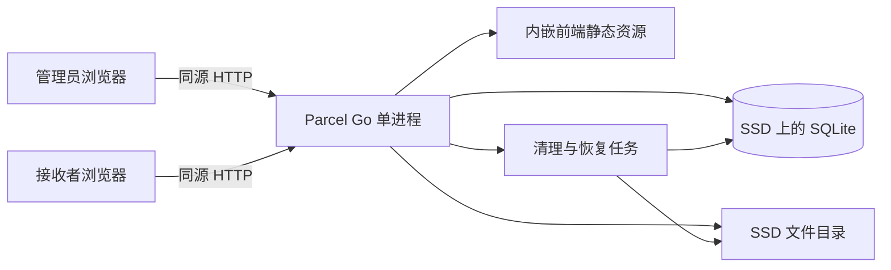

# Parcel 项目设计与开发计划

编写日期：2026-10-07（Asia/Shanghai）

状态：设计基准；v0.1 功能已实现并部署，验收范围与剩余项目见 [验收记录](acceptance.md)。

首个目标版本：v0.1，局域网可用的临时文件分享服务。

## 1. 目标与设计依据

Parcel 提供一个完整闭环：管理员上传文件 → 设置分享规则 → 发送一个链接 → 接收者验证并下载 → 文件失效后自动清理。

设计依据是引用的“设计文件中转站”讨论，以及本次明确的约束：先使用内网 IP，不引入 Cloudflare Tunnel。读取到的历史包含最近五轮，覆盖项目命名、单链接分享、IPv6 直连和部署资源；未覆盖更早的全部需求。下文的具体默认值与技术选型是本次设计建议，不视为此前已经确认的要求。

历史讨论中的部署资源为 Raspberry Pi 4B、SSD，以及曾使用的局域网地址 `192.168.5.16/24`。该地址用于文档示例，部署时须现场核实。历史上获得公网 IPv6 不等于当前入站可达；v0.1 不依赖公网 IPv6，也不改动 DMIT 上的现有服务。

### 1.1 v0.1 的完成标准

- 同一局域网内的电脑、手机能通过 `http://192.168.5.16:8080` 使用服务。
- 管理员能上传大文件，断线后从已确认的位置继续上传。
- 每个分享包含一个文件、一条链接，可设置密码、有效期、下载次数。
- 下载采用流式传输，支持 HTTP Range；内存使用不随文件大小线性增长。
- 并发下载不突破次数上限，重试和 Range 请求遵循明确的计数规则。
- 过期、撤销、次数耗尽的文件有确定的清理流程，服务重启后能恢复状态。
- 在真实树莓派与 SSD 上完成大文件、重启恢复、空间不足的验收。

### 1.2 首版范围

| 领域 | v0.1 实现 | 后续阶段 |
| --- | --- | --- |
| 网络 | 单一内网 IP、同源页面与 API | 域名、HTTPS、公网 IPv6 |
| 上传者 | 单管理员登录后上传 | 多用户、访客上传 |
| 分享 | 单文件、随机链接、可选密码、到期时间、下载上限 | 多文件包、二维码、更多分享策略 |
| 文件传输 | 顺序分块上传、上传续传、Range 下载 | 分块并行、跨入口续传 |
| 存储 | 本机 SSD 与 SQLite | S3 兼容存储 |
| 清理 | 自动过期清理、管理员撤销、残留修复 | 更多运维与统计能力 |
| 路径选择 | 当前同源地址直接下载 | 一个链接自动选择 Direct/Relay |

v0.1 的链接仅供可达该内网地址的接收者使用，不能直接发给互联网用户访问。首版不包含 Tunnel、DDNS、DNS 自动配置或公网开放端口。

## 2. 用户角色与界面设计

### 2.1 管理员

管理员负责上传、创建分享、查看状态、撤销分享与查看存储占用。首版只有一个管理员身份，无注册流程。管理员密码与分享密码分别管理。

### 2.2 接收者

接收者只需一条链接。受密码保护的分享先显示密码输入框，验证后显示文件名、大小、有效期、剩余新下载次数与下载按钮；无密码分享直接显示这些信息。

分享链接示例：

```text
http://192.168.5.16:8080/s/<随机分享ID>
```

密码单独传递，不放在链接中。分享 ID 使用密码学安全随机数，建议至少 128 bit 随机性，以 URL-safe 字符编码，不使用自增编号或示例中的短码。

### 2.3 页面与交互

| 页面 | 路径 | 内容与主要动作 |
| --- | --- | --- |
| 登录 | `/login` | 管理员密码、登录、失败与限流反馈 |
| 管理首页 | `/admin` | 上传入口、分享列表、已用及预留空间、失效状态 |
| 新建分享 | `/admin/new` | 文件拖放/选择、密码、有效期、下载上限、上传进度 |
| 分享管理 | `/admin/shares/:id` | 分享链接、规则、已发放下载次数、撤销、清理状态 |
| 接收页 | `/s/:id` | 密码验证、文件信息、下载、失效原因 |

桌面采用居中主内容区，管理页可以用列表；手机改为纵向卡片。视觉风格以浅色背景、清晰字号和一种强调色为主，先做好上传与接收两条流程。

新建分享的流程：选择文件 → 填写规则 → 上传 → 服务端校验 → 生成链接。上传完成前不生成可用分享。有效期从分享发布成功时开始计算。

上传状态必须包含“上传中、已暂停、等待重试、校验中、完成、失败”。进度展示已确认字节与当前请求发送量组成的整份文件传输进度，分块交接不重复累加；恢复位置仍由服务端确认，暂停或失败回到已确认位置。校验阶段单独显示，不把 100% 上传进度等同于已经可分享。首次支持同页面暂停/恢复；刷新后由用户重新选择原文件，客户端用文件名、大小、修改时间辅助匹配，并提示这些字段不能证明文件内容完全一致。

接收页不展示内部网络架构。下载交给浏览器原生下载功能，不在页面虚构下载完成状态或实时速度。过期/撤销/次数耗尽显示对应不可下载状态；受保护分享未解锁时不泄露文件名及大小。

内网 HTTP 下不能假定 `navigator.clipboard.writeText()` 可用，它受安全上下文限制。复制按钮须提供可选中文本的回退方案，不能把 HTTPS 专属浏览器能力作为首版必需条件。[MDN Clipboard 文档](https://developer.mozilla.org/en-US/docs/Web/API/Clipboard/writeText)

## 3. 技术架构

### 3.1 选型

| 层 | 建议方案 | 选择理由 |
| --- | --- | --- |
| 后端 | Go，优先标准库 `net/http` | 文件流处理与单进程部署直接，方便构建 ARM 版本 |
| 前端 | React + TypeScript + Vite，普通 CSS | 管理页面与上传状态适合组件化，构建后作为静态资源 |
| 元数据 | SQLite，SQL migration，`database/sql` | 单机低并发元数据，无需另行运行数据库服务 |
| SQLite 驱动 | `modernc.org/sqlite` | 无 CGO，文档列出 Linux ARM/ARM64 支持，先在 P0 验证实际目标架构 |
| 文件 | SSD 上的普通文件 | 临时文件直存，易做流式读写与回收 |
| 后台任务 | 进程内定时器 + 持久化状态 | 清理与恢复工作量适合单实例 |
| 交付 | 前端嵌入 Go 二进制，systemd 管理 | Pi 上运行时不需要 Node，也不必先引入反向代理 |

SQLite 驱动能力依据其[维护者文档](https://pkg.go.dev/modernc.org/sqlite)。开工时选定受支持的 Go、Node 和依赖版本，提交 `go.mod`、`go.sum` 与前端锁文件；本文不预先绑定未经构建验证的版本号。

### 3.2 运行结构



首版不运行 Redis、独立队列、对象存储或第二个后端实例。数据库不保存文件二进制。数据目录加独占进程锁，重复启动第二个写入实例直接失败。

### 3.3 模块边界

- `auth`：管理员登录、会话、CSRF、请求限流。
- `uploads`：配额预留、上传偏移、完成校验与重启恢复。
- `shares`：分享规则、密码验证、有效性与撤销。
- `downloads`：下载会话、原子计数、Range 与流式响应。
- `storage`：文件打开、写入、原子移动、安全删除。
- `cleanup`：到期扫描、残留回收、删除失败重试。
- `delivery`：生成当前同源下载地址，未来增加路径策略。

模块可用 Go package 表达，不拆成微服务。业务层不直接依赖 HTTP Host、公网域名或某个中转供应商。

## 4. 核心业务规则

以下默认值作为可配置的初始建议；最大文件与配额必须在部署时根据 SSD 的实际可用空间调整。

| 参数 | 初始建议 |
| --- | --- |
| 分享有效期 | 默认 24 小时，可选 1 小时、24 小时、7 天；上限 7 天 |
| 下载上限 | 默认 3 次，可选 1–100；首版无无限次选项 |
| 分享密码 | 可选；启用时建议 8 位以上，支持生成随机密码 |
| 单文件上限 | 8 GiB，使用 64 位大小与偏移 |
| 文件总配额 | 20 GiB，含已存文件及上传预留；实际部署可调 |
| 物理空间余量 | 至少保留 2 GiB；磁盘不足时停止接受新上传 |
| 上传分块 | 8 MiB，同一上传顺序提交一块 |
| 上传并发 | 最多 2 个活动分块请求，校验任务最多 1 个 |
| 下载并发 | 最多 4 个文件流；满载返回可重试错误，不消耗次数 |
| 未完成上传 | 24 小时无活动后回收 |
| 分享解锁授权 | 30 分钟，绑定单个分享及其权限版本 |
| 未启用下载票据 | 10 分钟有效，超时不消耗次数 |
| 已启用下载会话 | 空闲 30 分钟失效，绝对最长 8 小时 |
| 自动清理 | 每 60 秒扫描一次；启动时也执行恢复扫描 |

这里的“删除”指删除应用文件及其访问授权，不能承诺对 SSD 做不可恢复的物理擦除。

### 4.1 下载次数的定义

“一次下载”定义为：一个下载会话首次被准许返回文件内容，消耗一次下载资格。不是一次 HTTP 请求，也不以客户端完整保存文件为依据。浏览器是否成功落盘无法由服务端可靠证明。

接收流程：

1. 分享密码验证成功或确认无密码，获得分享授权。
2. 用户点击下载，服务端签发随机下载票据；此时不扣次数。
3. 首个有效文件 GET 在准备返回 `200` 或 `206` 时，事务内将票据启用并扣一次资格。
4. 同一个会话的后续 Range、重试不再扣次数；每个请求仍检查撤销、到期与会话有效期。
5. `HEAD`、`304`、无效 Range、鉴权失败、打开文件失败、并发槽位不足不扣次数。
6. 启用后的网络中断或进程崩溃不退还资格；在会话有效期内可使用同一票据续传。

活动传输按节流间隔更新会话的最后活动时间，避免仍在发送数据时被按空闲超时回收；绝对 8 小时上限不随活动延长。未启用票据设置每分享授权的数量上限与签发频率限制，防止大量无效会话堆积。

新请求先预检文件、Range 与条件头，取得传输槽位和文件引用，再执行计数事务。以条件更新实现：仅当分享仍可用且 `download_count < max_downloads` 时加一，同时把对应会话标为 active。更新零行时回滚；同一票据并发首次使用只能启用一次。事务提交后才发出成功响应头，数据库事务不跨越文件传输。

次数耗尽意味着不再启用新的下载会话；已经启用的会话仍可在未过期、未撤销的条件下续传。文件不能因最后一个名额用完而立即删除。

票据是 bearer 凭证，同一票据可以被持有者复用；次数限制不保证对应不同的人，也不保证限制文件被另行传播。首版不绑定接收者 IP，避免网络切换破坏续传。

### 4.2 到期与撤销

- 到期由每次请求实时比较服务端时间，不等待清理任务。
- 到期后禁止新下载及新 Range 请求；已开始的文件流允许完成，但受绝对会话时限约束。
- 管理员撤销时立即拒绝新请求、作废授权，并尽力取消正在运行的流；已发出的字节无法收回。
- 修改密码会提升权限版本并作废旧解锁与下载会话；首版发布后不延长有效期、不提高次数上限。需要新的规则时重新创建分享。
- 清理必须等待活动文件流退出。对次数耗尽的分享，还要等待已启用会话失效，避免破坏续传。
- 票据与会话到期在请求路径直接检查，过期的进程内任务负责回收记录及资源。

## 5. 文件上传与下载实现

### 5.1 顺序分块上传

采用小型 offset 协议，不宣称与 tus 协议兼容：

1. 登录后的管理员提交文件名、声明大小、分享规则草稿，创建上传会话。
2. 在事务内检查配额并预留完整文件大小，防止多个上传同时占满空间。
3. 客户端用 `File.slice()` 取块，以原始二进制请求体提交，携带 `Upload-Offset`。
4. 服务端对该 upload 加互斥锁，确认 offset 与已提交偏移一致，限制实际读入长度，然后流式追加到 `.part` 文件。
5. 一块完整写入并同步到磁盘后，再提交数据库 offset，最后回复新的确认偏移。请求失败时截断到原确认偏移。
6. 回复丢失时客户端先查询服务端偏移再决定下一块，禁止盲目重发追加。偏移冲突返回 `409` 与当前 offset。
7. 完成操作要求已提交字节数等于声明大小，进入 `finalizing`；后台流式计算 SHA-256，再把临时文件原子移动到最终路径。
8. 同步文件及目录后，在事务内发布分享，把预留空间转为实际占用，返回分享链接。

临时文件与最终文件位于同一文件系统，避免“合并所有分块”带来双倍磁盘占用。SHA-256 是文件完整性标识，不作为首版跨分享去重依据。

启动恢复时：如果 `.part` 长于数据库确认 offset，截掉未确认尾部；短于 offset 则标记失败，不伪造恢复成功。若崩溃发生在移动文件之后、发布事务之前，依据 `finalizing` 状态和预先记录的存储键重新校验并完成发布。完成操作必须幂等，同一上传只创建一个分享。校验任务持有上传活动引用并更新活动时间，取消与清理须等待任务释放引用，不能在哈希计算过程中删除文件。

超过声明大小、分块上限、最大文件大小均直接拒绝；不能只依赖 `Content-Length`。磁盘写入仍需处理 `ENOSPC`，预留配额不能防止其他程序占用磁盘。校验与写入异常进入可恢复或失败状态，并显示明确原因。

前端显示分块上传进度可使用 XHR 的上传事件。首版不要求 Service Worker、文件系统访问 API 或浏览器 Web Crypto；服务端负责最终哈希计算。

### 5.2 流式下载与续传

后端先鉴权、获取文件引用并处理计数，再使用文件句柄流式返回。Go 的 `http.ServeContent` 已提供 Range 和条件请求处理，可在严格控制计数的包装层内使用，避免重新实现整个 HTTP 文件协议。[Go net/http 文档](https://pkg.go.dev/net/http#ServeContent)

必须验证以下响应与行为：

- `Content-Disposition: attachment`，正确编码中文文件名，去除控制字符。
- `Content-Type: application/octet-stream` 与 `X-Content-Type-Options: nosniff`。
- `Content-Length`、`Accept-Ranges: bytes`、`206`、`Content-Range`、`416`。
- 基于文件哈希的稳定 ETag，以及 `If-Range` 的正确语义。
- `Cache-Control: private, no-store`，并设置 `Referrer-Policy: no-referrer`。
- 每个请求只允许一个 byte range；拒绝多范围下载，控制 Range 解析长度。
- `HEAD` 返回授权后的文件头，不计数；带条件头产生的非内容响应不计数。
- 不把整个文件读取为内存数组，不让前端 `fetch().blob()` 缓存整个大文件。

下载地址示意为 `/api/v1/downloads/<ticket>/file`，由浏览器原生下载处理。票据只返回给已授权的接收者，不出现在对外分享链接中；访问日志必须脱敏该路径，接收页不加载第三方资源。

普通 `<a>` 原生下载无法让网页可靠判断文件传输是否完成，也不保证每个浏览器都会自动续传。首版验收区分“服务端支持 Range 续传”和“浏览器行为”：用 curl 验证 Range，用目标浏览器验证实际暂停/恢复；页面允许在有效期内复用原票据重新下载，不承诺从断点自动接续。

## 6. 状态与数据模型

### 6.1 状态划分

上传状态：

```text
created → uploading → finalizing → completed
    └──────────→ canceled / expired / failed
```

分享的持久化状态为 `active / revoked / deleting / deleted / missing`。`expired` 和 `exhausted` 作为从时间、计数推导出的可用性原因，避免定时器未及时更新时错误放行。

```text
active（请求时校验到期与次数）
   ├── 撤销 → revoked
   ├── 文件缺失 → missing
   └── 满足回收条件 → deleting → deleted
```

删除失败保持 `deleting` 并重试，禁止重新开放访问。删除动作及配额释放必须幂等。

### 6.2 建议的表

| 表 | 关键字段与约束 |
| --- | --- |
| `admin_credentials` | 单管理员密码哈希、更新时间、权限版本 |
| `admin_sessions` | 随机 token 的哈希、到期时间、CSRF 信息；不持久化明文 token |
| `uploads` | ID、原始文件名、声明大小、确认 offset、规则草稿、预留字节、状态、最终存储键、最后活动时间、完成后的 share ID |
| `shares` | 随机 ID、唯一 upload ID、存储键、文件名、实际大小、SHA-256、密码哈希、发布/到期时间、次数上限、已用次数、权限版本、状态、删除信息 |
| `share_grants` | token 哈希、share ID、权限版本、到期时间 |
| `download_sessions` | token 哈希、share ID、权限版本、issued/active/revoked 状态、启用时间、最后活动时间、绝对到期时间 |
| `audit_events` | 管理动作、share/upload ID、结果码、时间；可选的短期排障信息 |

所有文件大小、offset 和累计字节使用 64 位整数。时间以 UTC 持久化，页面按客户端时区显示。首次启用下载会话与增加次数必须同一个事务，不能用内存计数替代。

文件目录示意：

```text
/srv/parcel/
  parcel.db
  parcel.db-wal / parcel.db-shm  # SQLite 运行时文件
  tmp/<upload-id>.part
  files/<随机存储键>
```

原始文件名只作展示，不拼接进真实路径。不开放 `tmp`、`files` 或数据库目录的静态访问。存储路径限制在受控根目录，拒绝路径穿越与符号链接逃逸。

SQLite 使用 WAL、外键与 busy timeout，写事务保持短小；定期 checkpoint。WAL 数据库放在本地 SSD，不放 NFS/SMB。WAL 支持读写并行但仍须处理写竞争，不用于文件流的长期锁。[SQLite WAL 官方说明](https://sqlite.org/wal.html)

### 6.3 清理与一致性

1. 扫描到期、撤销、次数耗尽和超时上传，计算是否仍有活动流或允许续传的会话。
2. 先标记禁止访问及 `deleting`，再执行磁盘删除，成功后标记 `deleted` 并释放占用。
3. 删除失败记录原因、重试时间与尝试次数，采用退避重试，管理页显示待清理空间。
4. 每次启动先核对 DB 与文件：最终文件缺失则标 `missing`；finalizing 则恢复；上传尾部则回滚；无引用的残留文件经过保护窗口后回收。
5. 状态切换、活动流引用与新请求准入共用明确的锁顺序，防止扫描后又有下载进入造成提前删除。
6. 文件删除后但 DB 未提交的崩溃，以“文件已不存在”作为幂等成功继续释放配额；未删除前不释放占用。

到期记录保留精简 tombstone 7 天以便显示失效原因，之后清除。审计记录默认保留 7 天且数量有上限。进程重启后活动流引用归零，下载会话与已用次数从 DB 恢复。

## 7. HTTP API

前缀统一为 `/api/v1`；以下路径已实现，配置详见运维手册。API 错误采用 `{code, message, request_id}`，不返回文件系统路径或底层 SQL。

| 方法 | 路径 | 权限及职责 |
| --- | --- | --- |
| POST | `/auth/login` | 验证管理员密码，建立会话 |
| GET | `/auth/session` | 返回管理员身份及 CSRF 信息 |
| POST | `/auth/logout` | 注销当前管理员会话 |
| GET | `/admin/status` | 管理员查看配额、空间、版本、待清理状态 |
| POST | `/uploads` | 管理员创建上传并预留配额 |
| GET | `/uploads/lookup` | 管理员用 Idempotency-Key 找回创建回复丢失的上传 |
| GET | `/uploads/:id` | 管理员查询 offset 与状态 |
| PATCH | `/uploads/:id` | 管理员提交二进制块和 `Upload-Offset` |
| POST | `/uploads/:id/complete` | 管理员幂等触发校验；返回状态或已创建分享 |
| DELETE | `/uploads/:id` | 管理员取消上传，进入回收流程 |
| GET | `/admin/shares` | 管理员分页查看分享 |
| GET | `/admin/shares/:id` | 管理员查看规则、计数与状态 |
| PATCH | `/admin/shares/:id/password` | 管理员更改密码并作废旧授权 |
| DELETE | `/admin/shares/:id` | 管理员撤销分享；异步物理清理 |
| GET | `/shares/:id` | 返回公开状态；受保护分享解锁后才返回元数据 |
| POST | `/shares/:id/unlock` | 验证分享密码，返回受限分享授权 |
| POST | `/shares/:id/download-sessions` | 验证分享授权并签发票据；不扣次数 |
| GET/HEAD | `/downloads/:ticket/file` | 下载或获取文件头；执行会话与规则校验 |
| GET | `/healthz` | 返回进程健康状态，无敏感信息 |
| GET | `/readyz` | 检查数据目录、数据库及初始化恢复完成情况 |

无密码分享在创建下载会话时可免解锁，但仍做来源与限流检查。密码授权通过受限 HttpOnly Cookie 传递，不放 localStorage；授权 Cookie 的 Path 限定到对应分享，支持多分享并存。

重要状态码：`401` 未授权，`404` 不存在，`410` 分享失效，`409` offset/状态冲突，`413` 大小超限，`416` 不可满足的 Range，`429` 频率超限，`503` 传输槽位不足或暂不可用，`507` 空间不足。

完成请求在校验未完成时返回 `202`，前端轮询 upload 状态；最终成功返回同一个 share。创建上传支持管理员提供的幂等键，避免断网重试反复预留空间。下载按钮串行处理点击并复用已有有效票据；签发响应丢失可重新申请，未启用票据不计数并受数量上限约束。数据库只保留票据哈希，不依靠重放已丢失的明文凭证实现幂等。

## 8. 身份验证与局域网部署约束

- 管理员及分享密码使用加盐 Argon2id，保存参数与哈希，不记录明文。参数在 Pi 上测量后固定，限制同时执行的哈希校验数，避免登录请求耗尽内存。[Go Argon2 文档](https://pkg.go.dev/golang.org/x/crypto/argon2)
- 管理员会话建议 12 小时有效；Cookie 使用 `HttpOnly`、`SameSite=Strict`。HTTP 内网阶段明确允许非 Secure Cookie；未来 HTTPS 模式必须启用 Secure。
- 所有有状态的写请求检查 CSRF token 与允许的 Origin；匿名解锁/下载票据签发也检查来源。CLI 管理请求使用管理员会话与 CSRF token。
- 校验 Host 与规范化后的 `BASE_URL` 一致，默认关闭跨域，不信任外部提交的 `X-Forwarded-*`。
- 管理员登录及分享密码尝试按 IP 与目标双重限流，例如每分钟 5 次失败后退避；返回可读的重试信息。
- 日志脱敏 Cookie、密码、分享授权和下载票据；不把完整凭证写入审计日志。
- 首次管理员密码通过本地交互式 CLI 设置，密码哈希保存在数据库；不随仓库提交默认密码。

首版 HTTP 的密码与文件未做传输加密，因此部署边界是可信局域网。公网阶段先完成 HTTPS 与访问边界设计，再开放服务。这是当前采用内网 HTTP 的实际约束。

绑定明确的内网 IPv4 地址，例如 `192.168.5.16:8080`，避免监听 `0.0.0.0` 或 `[::]` 后意外暴露到历史讨论中的公网 IPv6。访问地址通过配置生成，不从任意请求头推导。

## 9. 部署与运行方案

### 9.1 配置约定

以下为可运行的主要配置；完整样例包含挂载检查配置，见 [parcel.env.example](../deploy/parcel.env.example)：

```dotenv
PARCEL_LISTEN_ADDR=192.168.5.16:8080
PARCEL_BASE_URL=http://192.168.5.16:8080
PARCEL_DATA_DIR=/srv/parcel
PARCEL_REQUIRED_MOUNT=/
PARCEL_MAX_FILE_BYTES=8589934592
PARCEL_STORAGE_QUOTA_BYTES=21474836480
PARCEL_MIN_FREE_BYTES=2147483648
PARCEL_UPLOAD_CHUNK_BYTES=8388608
PARCEL_UPLOAD_IDLE_TTL=24h
PARCEL_DEFAULT_SHARE_TTL=24h
PARCEL_MAX_SHARE_TTL=168h
PARCEL_DEFAULT_DOWNLOAD_LIMIT=3
PARCEL_DOWNLOAD_IDLE_TTL=30m
PARCEL_DOWNLOAD_MAX_TTL=8h
PARCEL_CLEANUP_INTERVAL=60s
PARCEL_LOG_LEVEL=info
```

启动时验证 IP、BASE_URL、路径、上限关系与剩余空间，配置错误应明确失败。磁盘不足可以运行下载与清理功能，但上传接口返回空间不足。空间统计区分已用、预留、待清理及物理可用字节。

### 9.2 Pi 部署顺序

1. 核实 Pi 的 OS 位数、CPU 架构、实际 IP 和 SSD 文件系统；大文件目录不使用有 4 GiB 单文件限制的文件系统。
2. 在路由器中固定 DHCP 租约，确认地址仍为示例中的 `192.168.5.16`，否则修改配置。
3. 把 SSD 挂载到稳定位置，为专用 `parcel` 系统用户创建数据目录；DB、tmp、files 都放 SSD。
4. 构建目标架构二进制，初始化管理员密码及数据库，再启动 systemd 服务。
5. systemd 依赖 SSD 挂载，启动检查目录确实位于目标挂载，避免 SSD 掉线后写入系统盘；服务用非 root 用户运行。
6. 只允许实际局域网网段访问 TCP 8080。例如确认 UFW 已启用且网段确为 `/24` 后，使用 `sudo ufw allow from 192.168.5.0/24 to 192.168.5.16 port 8080 proto tcp`；保持已有 SSH 规则。
7. 用另一台局域网电脑及手机执行完整上传/分享/下载/撤销验收。若手机在访客 Wi-Fi，先确认客户端隔离是否影响可达性。
8. 验证开机启动、正常关机、强制退出恢复、SSD 未挂载时拒绝错误写入。

开发环境默认监听 `127.0.0.1:8080`；前端 dev server 将 `/api` 代理到 Go。Pi 交付用内嵌前端的单二进制，运行时无需 Vite。

Docker Compose 可以在后续交付中补充，不能成为首版运行前提。若增加容器部署，仍需绑定指定 LAN IP 并独立验证实际防火墙行为。

### 9.3 运维与资源

设置短的 Header 超时与空闲连接超时；上传分块设置超时，下载采用可续期的写入空闲超时，避免统一短 `WriteTimeout` 截断大文件。活动流不能无限阻塞退出或清理，绝对会话时限到达须取消。

进程输出结构化日志，包括 request ID、动作、结果、耗时及传输字节。v0.1 不部署监控平台，通过 systemd 日志与管理页诊断。备份采用停机一致性备份或 SQLite 支持的备份方式，不直接复制运行中的单个 `.db` 文件；临时分享文件默认不做长期备份，以免违背到期删除预期。

首次性能验收目标：2 个上传、4 个下载及 1 个校验任务下，进程 RSS 以低于 256 MiB 为调优目标；最终门槛依据 Pi 实际内存和测量确认。吞吐量报告记录客户端链路、磁盘和 CPU，不预先承诺固定速度。

## 10. 开发里程碑

按一名开发者估算共 12–15 个有效工作日，另预留硬件/网络环境问题的时间。阶段以验收结果为推进条件，日期不作为既定承诺。

| 阶段 | 预计工作量 | 开发任务 | 可检查的产物与验收 |
| --- | --- | --- | --- |
| P0：环境与工程 | 1 天 | 确认 Pi 架构；建立 Go/web 工程、锁文件、migration、构建脚本；验证 SQLite 驱动 | 最小二进制在 Pi 运行；DB 可读写；静态首页与 health/ready 可访问 |
| P1：管理与基础存储 | 2 天 | CLI 初始化管理员；登录/注销/CSRF；数据目录与独占锁；配置、存储配额、日志 | 未登录不能上传；重复实例失败；Host/Origin 拒绝生效；配置错误明确失败 |
| P2：可靠上传 | 2–3 天 | 创建会话、offset 分块、空间预留、恢复、校验、幂等发布 | 小文件及 8 GiB 文件哈希一致；断线/重启能续传；并发预留不超配额；中断完成操作不重复发布 |
| P3：分享与下载 | 3–4 天 | 单链接、密码授权、TTL、下载票据、计数事务、Range、撤销 | 最后一个名额并发时仅一个新会话启用；同票据 Range 不重复扣次；错误/HEAD 不扣次；撤销停止新请求 |
| P4：清理与产品界面 | 2–3 天 | 自动清理、待删除重试、残留修复；管理/接收页面；移动端与 HTTP 复制回退 | 到期即时不可下载；占用可回收；删除不打断合法续传；手机完成闭环；页面状态与后端一致 |
| P5：Pi 交付与验收 | 2 天 | systemd、挂载依赖、运行手册、故障与资源测试、CI/release | LAN 两台设备通过验收；未挂 SSD 不写系统盘；重启恢复；交付目标架构包与验收报告 |

P2 与 P3 是可靠性重点，不因 UI 已可演示就跳过边界处理。P5 完成才称为 v0.1 可用。

### 10.1 建议仓库结构

```text
cmd/parcel/                 # serve、管理员初始化、维护命令
internal/auth/
internal/uploads/
internal/shares/
internal/downloads/
internal/storage/
internal/cleanup/
internal/delivery/
internal/config/
internal/database/
migrations/
web/src/                    # React 页面与上传客户端
web/dist/                   # 构建产物，不手工编辑
deploy/systemd/
scripts/                    # 构建与验收辅助脚本
docs/development-plan.md
docs/operations.md          # 安装、配置与运维手册
docs/acceptance.md          # 实测结果，不预填“通过”
```

Go 二进制的资源嵌入由构建步骤负责。数据库 migration、配额、票据计数、清理状态用有意义的集成测试验证；前端聚焦真实上传/接收流程，避免为纯样式编写重复测试。

## 11. 验证矩阵与发布门槛

| 场景 | 预期结果 | 验证方式 |
| --- | --- | --- |
| 中文名、空文件、普通文件 | 名称正确，0 字节也可发布下载，哈希一致 | HTTP 集成测试及浏览器 |
| 8 GiB 文件 | 不溢出、流式传输、内存不随文件大小增长 | Pi 实测，传输前后 SHA-256 与 RSS |
| 上传回复丢失、offset 重复/跳跃 | 查询后恢复，数据不重复追加 | 协议集成测试 |
| 上传中强制退出、校验中强制退出 | 恢复确认偏移，完成操作幂等 | 进程故障测试 |
| 剩 1 次资格，20 个不同票据并发 | 只有一个票据启用，计数为上限 | DB 集成测试与 Go race 检测 |
| 同一票据首次并发、HEAD/Range/416/304 | 有效内容只计一次；非内容响应不计次 | HTTP 集成测试 |
| 次数耗尽后原会话续传 | 有效会话可续传，不发放新资格 | HTTP 集成测试 |
| 到期、改密码、撤销 | 每次请求按规则拒绝，旧授权作废 | 可控时钟集成测试 |
| 清理与下载同时发生 | 无提前删除，新请求不越过删除边界 | 并发集成测试 |
| DB 更新/文件移动/文件删除中崩溃 | 最终文件与配额恢复一致 | 故障注入测试 |
| 磁盘不足或 SSD 未挂载 | 拒绝上传或启动，不写错磁盘、不误发布 | 可控容量目录及 Pi 实测 |
| 路径穿越、恶意文件名、错误密码 | 无目录逃逸，无脚本执行，无元数据泄露 | HTTP 集成测试 |
| 缺失 CSRF、外部 Origin/Host | 写入被拒绝，正常 LAN 流程可用 | HTTP 集成测试 |
| 桌面 Chromium、Firefox、手机 Safari/Chrome | 分享闭环可用，HTTP 复制有回退 | 人工 E2E；无法取得的设备注明未测 |

发布前必须满足：

- Go 测试、并发 race 检测、前端类型检查与构建通过。
- 在实际目标架构完成运行验证，不能以交叉编译成功替代部署测试。
- 上述计数、恢复、清理、8 GiB 与磁盘边界验收有实测记录。
- 运行手册包括首次初始化、IP 变更、升级回滚、数据目录和故障处理。
- CI 生成与当前源码匹配的产物；依赖与二进制版本可追溯。

## 12. 后续网络演进

v0.1 的分享资源与下载授权不绑定某个网络入口。当前 `delivery` 只返回同源路径，不运行 IPv6 探测，不提供不存在的 fallback。

后续可分两个独立版本推进：

1. **v0.2：域名与 HTTPS、公网 IPv6 直连。** 现场确认路由器/主机防火墙、实际公网地址与跨网可达性；再做动态地址更新。IPv6-only 入口仍不能覆盖没有 IPv6 的互联网客户端。
2. **v0.3：单链接的 Direct/Relay 自动选择。** 在有实际可用的通用入口后，增加直连探测及候选下载地址；具体中转方案届时评估。Cloudflare Tunnel 只可能作为后续选项，当前没有安装、配置或依赖它。

未来多入口应共享同一份分享状态、下载会话与次数事务，切换入口不重新扣次数。需要定义跨域授权、CORS、HTTPS、浏览器私网访问限制及路由错误重试，再接入公网；仅凭一次 ping 成功不保证文件传输可达。

原生浏览器下载开始后，页面无法可靠观察其中途失败并自动切换入口。后续先解决下载前的路径选择；若要求传输中自动切换并保持进度，需要另外设计能管理 Range 的下载客户端，并验证浏览器对文件写入的支持，不能在首版宣传为已实现功能。

## 13. 开工顺序与待核实项

已按 P0 → P1 → P2 → P3 → P4 → P5 实现功能并部署到当前 Pi。实际确认的环境及尚未完成的跨设备验收见 [验收记录](acceptance.md)。迁移到其他主机时仍需核实：

- Pi 是否使用 64 位系统；目标为 ARM64 还是 ARMv7。
- SSD 的实际挂载点、文件系统、可用容量及拟分给 Parcel 的配额。
- 当前 LAN IP、客户端可达网段及路由器 DHCP 保留配置。
- 分享密码是否需要默认强制启用；本草案暂定可选。

首版优先交付可验证的上传、分享、下载和清理闭环。公网网络路径按独立里程碑继续演进。
