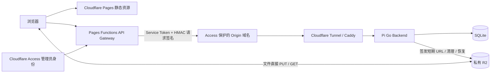

# Pages、Access 与 R2 部署

上线日期：2026-10-10（Asia/Shanghai）。公网已切换到 Pages；树莓派仅提供经过 Access 与网关验签的内部 API。原 Tunnel + 密码模式仍保留供开发及回滚使用。



Pages 使用 [Advanced mode](https://developers.cloudflare.com/pages/functions/advanced-mode/) 的 `_worker.js`，静态文件来自 `ASSETS`，API 经同源 `/api/v1/` 路由。Pi 保留 SQLite、下载次数原子更新、分享生命周期、R2 URL 签发和清理恢复。网关不持有 R2 S3 密钥，不代理文件正文。

## 已实现的边界

- 严格路由/方法/分享 ID 白名单；不暴露 health/readiness、未知路径、Go 静态页面、二进制上传和本地下载。
- API 请求最大 64 KiB，正文读取和 Origin 请求分别限时 15 秒；JSON 初验、Origin 与跨站 API 检查。分享页面允许从邮件和其他网站导航进入。
- 管理页面和 API 验证 Access JWT 的 RS256 签名、issuer、管理员应用 AUD、到期时间、用户身份和邮箱白名单。仅邮箱头、服务令牌或 Parcel 密码均不能替代身份验证。[Cloudflare JWT 验证说明](https://developers.cloudflare.com/cloudflare-one/access-controls/applications/http-apps/authorization-cookie/validating-json/)
- 内部 Origin 使用独立 Access **Service Auth** 应用；网关每次发送 `CF-Access-Client-Id` / `CF-Access-Client-Secret`。[服务令牌文档](https://developers.cloudflare.com/cloudflare-one/access-controls/service-credentials/service-tokens/)
- Go 额外验证 HMAC 请求签名（内部 Access Cookie 被过滤，仅绑定当前分享 grant）：时间戳、随机 nonce、方法、路径/参数、公网 origin、身份、客户端 IP、正文摘要、Content-Type、CSRF、幂等键和分享 cookie。有效时间窗为过去 60 秒至未来 15 秒；进程内 nonce 保留两分钟，拒绝重放。Pi 和 Cloudflare 时钟须同步。TLS/Access 是传输边界；nonce 缓存重启后不会持久保留。
- Access 管理会话每次从已验证身份授权，CSRF 绑定身份；无需 Parcel 管理密码或新数据库表。退出先校验 CSRF，再导航至 `/cdn-cgi/access/logout`。[Access 退出行为](https://developers.cloudflare.com/cloudflare-one/access-controls/access-settings/session-management/)
- API、管理 HTML 和入口 HTML不缓存。浏览器伪造的身份/转发头、Access cookie、服务凭据不会透传；只传当前分享的 grant cookie，响应只保留 Parcel grant cookie。
- 网关每个运行实例每分钟限制公开 API 120 次、管理员 API 600 次、解锁/签发/续签合计 20 次；最多保留 10,000 个限流键。**这不是跨所有实例的全局限流**。Go 的分享密码与票据限制仍保留；流量级保护由下文 WAF 规则承担。
- 只接受 `PUBLIC_URL` 正式域名。`pages.dev` 和预览域名不接入生产 Origin。缺少配置默认返回 503，无法验签默认拒绝。

旧本地文件均为可丢弃实验数据，本次不迁移。Pages 模式仅提供 R2 控制面；本地传输路径禁用。默认局域网/旧 Tunnel 模式仍保留供开发测试使用。

## 当前上线状态

2026-10-10 已创建 Git 集成的 Pages 项目 `parcel`（`parcel-yck.pages.dev`），生产分支 `main`，Node 24，构建命令 `./scripts/build-pages.sh`，输出 `dist/pages`。首次部署成功；运行时兼容日期为 `2026-10-09`，配额耗尽行为已设为 **Fail closed**。

已创建 `parcel-admin` 和 `parcel-origin` 两个独立 Access 应用。管理员应用覆盖下文七个目标，只关联管理员邮箱 Allow 策略，并启用 HttpOnly cookie；Origin 只关联专用服务令牌的 Service Auth 策略。`parcel-pi` Tunnel 已添加内部 Origin 路由，并要求校验 `parcel-origin` 应用 JWT。服务令牌有效期至 2027-10-10，三项密钥均已存入 Pages Production Secrets，普通运行变量也已配置。凭据仅保存在被 Git 忽略的 `.parcel-secrets/` 和 Pi 上；不写入本文。

公网 `parcel.playereconlab.com` 已作为 Pages custom domain 激活，SSL 已启用；DNS CNAME 指向 `parcel-yck.pages.dev`。Pi 活动配置已切换为 Access 模式，Caddy 只为内部 Origin 提供 API，后端监听 `127.0.0.1:8081`。三个 systemd 服务均 active，本机 readyz 通过。旧公网 Tunnel route 保留供回滚，DNS 已不再指向它。

- 当前 ARM64 二进制 SHA-256：`541718bf85466e046b9e52d50bf5c326fb32282efaea63b63ef3f60a42026c3b`，部署前已核对本机与 Pi 暂存文件一致。
- 首次准备备份：Pi `/etc/parcel/pages-prep-20261009-220259/`；正式切换配置备份：`/etc/parcel/pages-cutover-20261010-002805/`。
- 本次二进制备份：`/opt/parcel/parcel.before-pages-cookie-fix`。R2 凭据、SSD 数据、SQLite schema 3 和 Pi checkout 的未提交修改均保留。
- HMAC 文件：Pi `/etc/parcel/gateway.secret`（0600）；Pages Secret 使用同一密钥。不要重新生成覆盖。
- Pages 上线修复：后端不可用统一返回 503 JSON（避免 Cloudflare 替换 502 错误正文）；Origin Access 注入的 `CF_Authorization` Cookie 不参与 Parcel HMAC，验签后仅保留当前分享 grant；SPA 从 ASSETS 的 `/` 读取入口，避免 Pages 将 `/index.html` 重定向至 `/` 形成循环。
- WAF `parcel-share-actions`：公网分享解锁、签发和续签合计每 IP 每 10 秒最多 10 次，超限 Block 10 秒。当前 Free 套餐只有一条速率限制规则和 10 秒窗口；应用自身的分钟级限制仍生效。
- 缓存规则 `parcel-private-no-cache`：公网及 Origin 的 `/api/*`、`/login`、`/admin`、`/admin/*` 绕过缓存。Cloudflare 托管规则集在安全设置中显示始终启用。
- R2 公共开发 URL 已禁用，无公开 custom domain；CORS 仅允许正式公网 origin 的 GET、HEAD、PUT。
- Pi 尚未安装自动升级服务；以后启用时须设置下文的本机健康检查地址。

验证结果：完整 Go race/vet 通过；网关 11 项测试、真实 Go 联调、workerd 打包运行及 Chromium/Firefox Access UI 测试通过。上线后 15 项匿名公网检查全部通过：首页与分享页 200、未知分享 API 404、管理员及上传入口跳转 Access、内部 Origin 拒绝匿名访问、维护与本地文件路由不公开。真实 Origin 签名请求通过，重复 nonce 被拒绝。停机验证确认 Pi 后端离线时首页仍返回 200，公开 API 返回 503 JSON `origin_unavailable`；恢复后三个服务 active、本机 readyz 通过。另用生成的验收文件验证直接 R2 PUT/GET、公开分享密码 grant、无密码分享匿名下载、同会话续签不重复计数、并发仅消费剩余一个下载名额、到期与撤销后禁止续签。生成的测试分享均已撤销；SQLite 显示三个未签下载 URL 的测试分享已自动清理，两个签过 URL 的分享按保留期限等待清理（共 94 字节）。

**真实管理员 Access 邮箱登录及登录后的浏览器上传闭环仍待验证码完成。** 上述 Origin 运维签名探测不替代真实管理员 JWT 验收。R2 已签 URL 的有效窗口与延迟清理按下文及 R2 文档执行；不提前删除仍处于已签 URL/会话保留期的对象。

## 本地构建与验证

```bash
./scripts/build.sh                        # 原有 Go + 内嵌 UI
./scripts/build-pages.sh                  # dist/pages，独立 Access UI 与网关
npm --prefix cloudflare test
PARCEL_TEST_BINARY="$PWD/bin/parcel" npm --prefix cloudflare run test:integration
npm --prefix cloudflare run test:runtime  # 对打包文件运行真实 workerd
npm --prefix cloudflare run test:browser  # Access UI；先安装 web Playwright 浏览器
```

`dist/pages` 是唯一 Pages 上传目录，包含静态文件、`_worker.js` 和 `_routes.json`。它不包含凭据。Pages 构建不覆盖 `web/dist`，不会把 Access UI 意外嵌入本地密码模式的程序。Go schema 保持 3；CI 同时验证网关、workerd、真实 Go 联调及原有测试。

## Dashboard 配置参考（本账户已配置）

建议保留公网地址 `https://parcel.playereconlab.com`，新建内部地址 `https://parcel-origin.playereconlab.com`。内部地址仅供网关使用；无需路由器入站端口。

### 1. 创建内部 Origin 和 Service Token

1. 在现有 Tunnel 添加 published application：`parcel-origin.playereconlab.com` → `http://127.0.0.1:8080`，不设置 path filter。暂时保留原公网 Tunnel route。
2. 创建 Access Service Token，例如 `parcel-pages-origin`，保存 Client ID 和 Client Secret。
3. 创建 self-hosted Access 应用，覆盖整个 `parcel-origin.playereconlab.com`。唯一允许策略为 **Service Auth**，Include 仅选择上述 Service Token。不要用 Allow、Everyone 或 Bypass。
4. 记录该 Origin 应用 AUD。建议在 Tunnel 的 Origin Access 验证选项中启用 JWT 验证，填 Zero Trust team name 与 **Origin 应用 AUD**；本地管理的配置样例是 [cloudflared.pages.example.yml](../deploy/cloudflared.pages.example.yml)。

### 2. 创建管理员 Access 应用

创建一个 self-hosted Access 应用，把以下路径放在**同一个应用**（共享同一 AUD）中，Allow 策略仅允许你的管理员邮箱，按需要求 MFA：

| 域名 | 必须保护的路径 |
| --- | --- |
| `parcel.playereconlab.com` | `/login` |
| `parcel.playereconlab.com` | `/admin` 与 `/admin/*` |
| `parcel.playereconlab.com` | `/api/v1/auth/*` |
| `parcel.playereconlab.com` | `/api/v1/admin/*` |
| `parcel.playereconlab.com` | `/api/v1/uploads` 与 `/api/v1/uploads/*` |

`/*` 不覆盖父路径，`/admin` 和 `/api/v1/uploads` 必须各自保留精确目标。[路径匹配说明](https://developers.cloudflare.com/cloudflare-one/access-controls/policies/app-paths/) 不要保护整个公网域名：`/`、`/assets/*`、`/s/*`、`/api/v1/shares/*` 必须允许普通接收者。不要对管理员路径设置 Bypass。不要给管理员应用允许 Origin Service Token。

记录 Zero Trust team domain（`https://<team>.cloudflareaccess.com`）和**管理员应用 AUD**，它们与 Origin 应用 AUD 不同。

### 3. 创建 Pages 项目与运行变量

可使用 Git 集成：仓库根目录构建命令 `./scripts/build-pages.sh`，输出目录 `dist/pages`，设置构建环境 `NODE_VERSION=24`。也可 Direct Upload 本地的 `dist/pages`，必须使用 Wrangler 上传包含 Functions 的构建产物：

```bash
cd cloudflare
npx wrangler pages deploy ../dist/pages --project-name parcel
```

`cloudflare/wrangler.jsonc` 仅用于本地开发，刻意省略 `pages_build_output_dir`；生产运行变量和绑定由 Dashboard 管理，避免空 Wrangler 配置覆盖 Dashboard 设置。上传时显式给出 `../dist/pages`。生产兼容日期设为 `2026-10-09`；若之后改用 Wrangler 管理生产配置，应先下载现有配置并完整核对。[配置来源说明](https://developers.cloudflare.com/pages/functions/wrangler-configuration/#source-of-truth)

在 Pages 的 **Production** 环境配置以下运行变量。切勿把 secret 作为 `VITE_*` 变量，它们不进入前端：

| 名称 | 类型 | 值 |
| --- | --- | --- |
| `PUBLIC_URL` | 普通变量 | `https://parcel.playereconlab.com` |
| `ORIGIN_URL` | 普通变量 | `https://parcel-origin.playereconlab.com` |
| `ACCESS_TEAM_DOMAIN` | 普通变量 | 你的 `https://<team>.cloudflareaccess.com` |
| `ACCESS_AUD` | 普通变量 | 管理员应用 AUD |
| `ADMIN_EMAILS` | 普通变量 | 允许的管理员邮箱；多个以逗号分隔 |
| `R2_ENDPOINT` | 普通变量 | 与 Pi 的 `PARCEL_R2_ENDPOINT` 相同 |
| `GATEWAY_HMAC_SECRET` | Secret | 与 Pi `/etc/parcel/gateway.secret` 内容完全一致的 64 位 hex |
| `ORIGIN_ACCESS_CLIENT_ID` | Secret | Origin Service Token Client ID |
| `ORIGIN_ACCESS_CLIENT_SECRET` | Secret | Origin Service Token Client Secret |

变量修改后重新部署。不要把 production secret 配到 preview；预览域名也会被网关拒绝。设置 Functions 配额耗尽行为为 **Fail closed**，避免函数被绕过。不要上传 `.parcel-secrets`、`.dev.vars`、数据库或 `/etc/parcel` 文件。

### 4. WAF / 缓存 / R2

- 保留私有 R2 桶，关闭公开 `r2.dev` 和公开 custom domain；使用已配置的 [R2 CORS](../deploy/r2-cors.json)。公网域名不变时无需更改 CORS；更换域名则同步 AllowedOrigins 与 PUBLIC_URL/BASE_URL。
- 对公网域名 `/api/v1/shares/*/unlock` 配速率限制：单 IP 每分钟 10 次；对签发和 refresh 路径配置每分钟 30 次；其余 API 可从单 IP 每分钟 600 次开始。按账户套餐可用的规则数合并，超限选择 Block。原生下载 PUT/GET 在 R2 S3 端点，不能套这些 API 规则。
- 启用适用的 Managed Rules。API 使用 Block，避免 HTML challenge 导致 JSON 客户端失败；不要要求普通分享接收者登录 Access。
- 为公网与 Origin 的 `/api/*` 设置缓存 Bypass，管理页面 `/admin*`、`/login` 也 Bypass。避免任何 Cache Everything 规则覆盖这些路径。

## Pi 准备与切换

在开发机生成密钥；文件权限 0600，勿粘贴到聊天或提交 Git：

```bash
install -d -m 0700 .parcel-secrets
(umask 077; openssl rand -hex 32 > .parcel-secrets/gateway.secret)
scp .parcel-secrets/gateway.secret hyphy@100.125.38.115:/tmp/parcel-gateway.secret
ssh hyphy@100.125.38.115 'sudo install -o parcel -g parcel -m 0600 /tmp/parcel-gateway.secret /etc/parcel/gateway.secret && rm /tmp/parcel-gateway.secret'
```

若密钥已准备，复用该文件，切勿重新生成覆盖。Dashboard Secret 必须使用同一值。

完成 Dashboard 的内部 Tunnel 和两个 Access 应用后，合并 [parcel.pages.env.example](../deploy/parcel.pages.env.example) 到 `/etc/parcel/parcel.env`。保留 R2 凭据、SSD 路径、配额等现有配置。备份当前配置，使用替换好两个域名的 [Caddyfile.pages.example](../deploy/Caddyfile.pages.example)，先 `sudo caddy validate --config <暂存配置>`。新版二进制按照 [仓库部署规范](../AGENTS.md) 交叉构建、比较本地/远端 SHA-256、保留上一二进制后安装。

Dashboard 中将公网域名从旧 Tunnel route 迁到 Pages custom domain。先保留旧 route/DNS 信息与 Caddy/env 备份，以便回滚。Cloudflare 同一公网域名不能同时作为现有 Tunnel CNAME 和 Pages custom domain；域名迁移要和 Pi Caddy/env 切换配合完成。不要提前删除仍在服务的旧 route。

切换后验证：

```bash
# Pi 本机维护端点；不依赖公网 /readyz 或 Access 登录。
ssh hyphy@100.125.38.115 'systemctl is-active parcel caddy cloudflared && curl -fsS http://127.0.0.1:8081/readyz'
python3 scripts/pages-acceptance.py \
  --base-url https://parcel.playereconlab.com \
  --origin-url https://parcel-origin.playereconlab.com
```

升级器 `/etc/parcel/update.env` 设置 `PARCEL_HEALTH_URL=http://127.0.0.1:8081/readyz`；网关模式仅直接回环连接允许健康检查，不信任转发头。

最后由管理员实际登录、上传到 R2、创建有密码与无密码分享，用未登录窗口下载并刷新同一下载会话，检查计数不重复增加，再撤销并检查清理。公网页面依旧可加载，而 Pi 离线时 API 明确报错；文件下载在已签 URL 的有效期内仍可进行。已签 R2 URL 最长 5 分钟的可用窗口及清理语义沿用 [R2 文档](r2-storage.md)。

回滚时恢复旧 Pages/custom-domain DNS/Tunnel route、旧 Caddy 和 parcel.env，再重启三个服务并验证公网与本机健康检查。schema 未变化，恢复原有配置可继续使用原来的密码模式；R2 数据和凭据不需删除。
