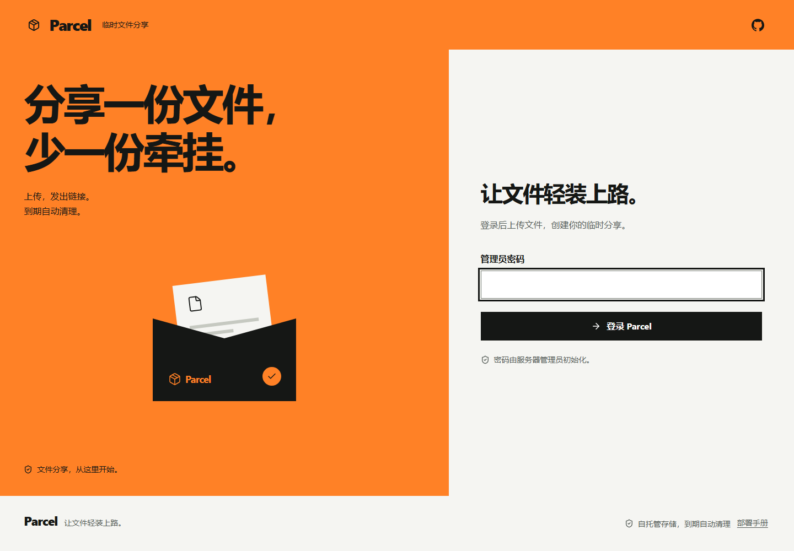
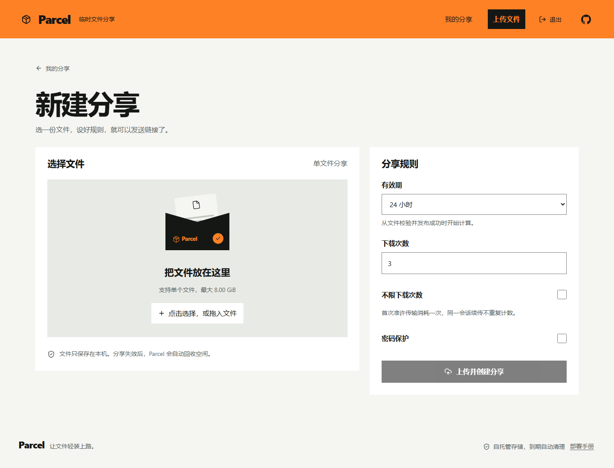

# Parcel 界面统一与验收

2026-10-19。将登录、分享列表、上传、发布成功、分享弹窗、详情、密码解锁和接收页面统一为 [parcel-guide](https://parcel-guide.pages.dev/) 的橙黑风格。保留现有接口、鉴权、传输和清理语义。

## 设计

沿用手册的 **The product performs** 方向，seed `589754336`，保留品牌字体与色彩，不重新抽取方向。橙色 `#ff8126`、黑色 `#151715`、纸白 `#f5f5f2`，Segoe UI / 中文系统字体，直角控件，无装饰阴影、渐变、眉题和步骤徽标。深色模式采用中性深绿黑与同一橙色。

概念：Parcel 自己的文件信封成为橙色的寄送台，贯穿登录、空列表与上传选择。真实交互是文件选择、分享规则、复制链接与下载；信封只在输入、聚焦和提交时反馈，支持减少动态效果。

所有插画均为项目已有信封的 CSS 绘制，没有外部图片、视频、字体下载或需要替换的示例文案。文件名保持完整可读，并从大标题移至正文，避免长文件名挤占操作区域。页脚连接手册的中文入口。





## 截图复核

ROUND 1

- 第一眼：橙色寄送台与文件信封。
- 构图：登录左右分栏；分享页为实际额度和记录；上传为文件与规则；接收为文件与下载操作。
- 首轮问题：手机说明文字过窄、信封贴近标题；浅色登录容器背景未显式声明；超长文件名的大标题占用过多屏幕。
- 修复：手机采用标题通栏、正文与信封并排的网格；显式设置背景；固定页面标题并将文件名独立排版。

ROUND 2 / FINAL

- 复核 1440、768、390px 截图，并对 320px 做额外检查；检查明暗主题及正常、超长文件名。
- 应用界面自评：design 7.8 · usability 8.5 · creativity 7.0 · content 8.0 → 7.9/10。主要局限为系统字体在不同平台上的字形差异；手机长表单需要纵向滚动。
- 未将应用界面视为营销落地页：该设计 skill 明确排除 dashboards/app screens。原始 inspector 仍报告 `few-pictures`、`still-page` 两个营销门槛，以及 `no-footage` 警告；没有添加无关照片或入场动画、没有屏蔽原始报告，也不声称原始 inspector 全部通过。若机械套用其营销评分上限，原始评分为 6.0。布局、字号、对比度、溢出、眉题、渐变和阴影检查均无其余报告问题。
- 源码 lint：0 FAIL；4 WARN 均为原有代码标识符 `unlock` 和密码哈希的十六进制 `padStart`，不是页面宣传语或装饰编号。

## Web Interface Guidelines

按 2026-10-19 重新获取的 [Web Interface Guidelines](https://raw.githubusercontent.com/vercel-labs/web-interface-guidelines/main/command.md) 复查。

```text
web/src/main.tsx: ✓ pass
web/src/style.css: ✓ pass
web/src/login.css: ✓ pass
web/src/api.ts: ✓ pass
web/index.html: ✓ pass
```

可见焦点与跳转链接、原生表单语义、整行复选框命中区、错误关联和焦点恢复、无效分享与连接失败的标题和恢复说明、异步状态播报、危险操作确认、离页提示、分页 URL、原生选择框明暗配色、安全区、减少动态效果及长内容均纳入检查。数值和日期使用 Intl；品牌、文件名和只读链接禁止自动翻译。

## 验证

- TypeScript、两种鉴权模式的生产构建与 Prettier 检查通过。
- Go `go test -race ./...`、`go vet ./...` 通过；在 WSL 使用 go.mod 的 Go 1.26.8，Windows 无法构建项目使用的 Unix 文件锁接口。
- Cloudflare V3 后端测试 30 项通过；部署与凭据工具测试 13 项在 Linux 通过。
- 浏览器覆盖 Chromium、Firefox 和手机 Chromium；完整运行发现的问题修复后重跑受影响测试。公网 93 MB 上传测试继续按既有环境变量显式启用。
- 实际 workerd / D1 / R2 浏览器闭环覆盖上传、密码、下载和撤销；Firefox 在 Linux 运行，避免 Windows Firefox 启动限制。
- axe-core 对 12 种页面状态 × 2 种主题 × 4 个宽度（1440、768、390、320）检查，共 96 组，0 违规、0 横向溢出。规则包含 WCAG 2 A/AA、2.1 AA 与 best-practice。
- 96 组截图和原始检查报告位于忽略目录 `.taste-skill/app-review/`；原始三宽度 inspector 输出位于 `.taste-skill/app-final/`。

生产实例使用 Cloudflare Worker 与 main 分支自动构建部署；部署时核对该提交的构建结果、正式资源、公开接收 API 和管理员 Access 跳转。无需为此次界面更新更改 D1 schema、运行变量或存储对象。

