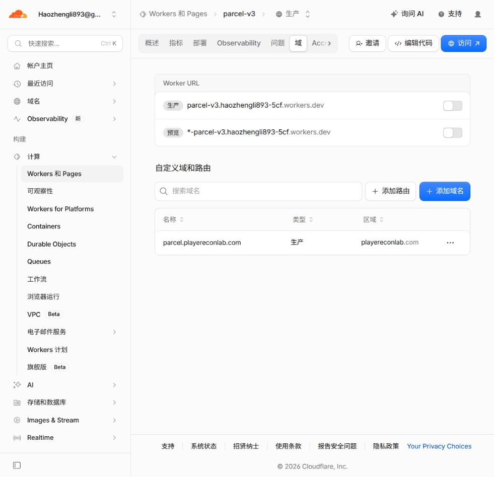
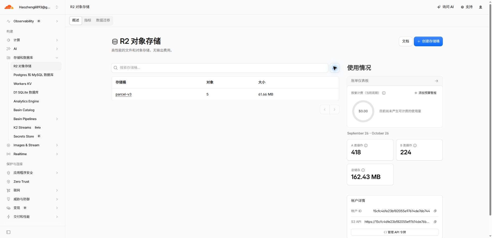

# Parcel V3 实例配置记录

核对时间：2026-10-10 16:05（Asia/Shanghai）。本文记录当前正式实例，依据 Cloudflare API、实际控制台截图和树莓派服务状态核验。密码、API Token、S3 凭据及会话密钥均不写入本文。

## 当前架构与资源

正式入口为 <https://parcel.playereconlab.com>，管理后台为 <https://parcel.playereconlab.com/admin>。页面与 API 均由 Worker 托管，D1 保存分享、上传任务、原子下载计数及配额，浏览器直接与私有 R2 传输文件。当前实例使用 Workers Free，业务链路不依赖 Pages、树莓派、Tunnel 或内部 Origin 服务令牌。

| 项目 | 当前配置 |
| --- | --- |
| Cloudflare 账户 ID | `15cfc46fe23bf82055e97614de76b744` |
| Worker | `parcel-v3`，production |
| 正式自定义域 | `parcel.playereconlab.com` |
| Workers 套餐 | Free；未开通 Workers Paid |
| `workers_dev` / `preview_urls` | 均为 `false` |
| 前端绑定 | `ASSETS` → `dist/v3-web/`；`run_worker_first:true`；SPA fallback |
| D1 绑定 | `DB` → `parcel-v3` |
| D1 ID | `51ffcd9f-e069-4c14-b341-f05e93626ed8` |
| R2 绑定 | `FILES` → 私有桶 `parcel-v3` |
| R2 S3 端点 | `https://15cfc46fe23bf82055e97614de76b744.r2.cloudflarestorage.com` |
| Cron | `*/5 * * * *`，每 5 分钟 |
| API 限流绑定 | `API_LIMITER`：300 次 / 60 秒，namespace `7391` |
| 管理限流绑定 | `ADMIN_LIMITER`：3000 次 / 60 秒，namespace `7392` |

限流绑定之外，敏感操作还有 D1 控制的全局限流；上述绑定额度不是整个账户的请求或账单额度。



## Worker 配置填写位置

Dashboard → Workers 和 Pages → `parcel-v3` → 设置：域和路由管理正式域名，变量和机密管理普通变量及 Secrets，绑定管理 D1、R2、Static Assets 和限流资源，触发事件管理 Cron。正式 Wrangler 文件也保存了变量、绑定和 Cron；后续部署须使用这份正式配置。

| 普通变量 | 当前值 |
| --- | --- |
| `PUBLIC_URL` | `https://parcel.playereconlab.com` |
| `ACCESS_TEAM_DOMAIN` | `https://montanaaaa.cloudflareaccess.com` |
| `ACCESS_AUD` | `0195049ba0f9f29b94c34aafb9be24a8b51eb2bc77cb3732c3bd961398062ed3` |
| `ADMIN_EMAILS` | `Haozhengli893@gmail.com` |
| `R2_ENDPOINT` | 上表中的 S3 端点 |
| `R2_BUCKET_NAME` | `parcel-v3` |
| `STORAGE_QUOTA_BYTES` | `21474836480`（20 GiB） |
| `MAX_FILE_BYTES` | `8589934592`（8 GiB） |
| `ACTIVE` | `true` |
| `WORKERS_PLAN` | `free` |
| `CLEANUP_BATCH_SIZE` | `1` |
| `MAINTENANCE_SINCE` | `0` |

以下三项已设置为 Worker 的 `secret_text`，本文仅记录名称：

- `R2_ACCESS_KEY_ID`：用于 R2 S3 签名。
- `R2_SECRET_ACCESS_KEY`：与访问密钥配对。
- `SESSION_SECRET`：保护会话并加密数据库中的密码验证记录，须长期保留、单独加密备份。直接替换或丢失会影响已有密码分享，轮换须先做受控重新加密。

`CLOUDFLARE_API_TOKEN` 是本机部署工具使用的管理凭据，不作为业务 Worker 的 Secret。当前管理 Token 名称为 `Parcel V3 Deploy`；R2 S3 凭据与管理 Token 用途不同。

## 管理员 Cloudflare Access

Dashboard → Zero Trust → Access → Applications → `parcel-admin`。

| 项目 | 当前值 |
| --- | --- |
| Team domain | `https://montanaaaa.cloudflareaccess.com` |
| 应用 | `parcel-admin` |
| 应用 ID | `86fc9dbb-5c03-4a42-b220-5e7c780e2dee` |
| Access 登录会话 | `24h` |
| 策略 | `parcel-admin-email-only`，Allow |
| 允许邮箱 | `Haozhengli893@gmail.com` |
| Require / Exclude | 均为空 |

该应用复用正式域名原管理员应用，其 AUD 与 Worker `ACCESS_AUD` 一致。应用覆盖以下七个 destinations：

```text
parcel.playereconlab.com/login
parcel.playereconlab.com/admin
parcel.playereconlab.com/admin/*
parcel.playereconlab.com/api/v1/auth/*
parcel.playereconlab.com/api/v1/admin/*
parcel.playereconlab.com/api/v1/uploads
parcel.playereconlab.com/api/v1/uploads/*
```

公共分享页面与公共分享 API 保持可访问。Worker 继续校验 Access JWT 的签名、issuer、audience、邮箱与有效期，并执行 Origin、CSRF 及请求校验。V3 不使用 V1 的 Origin Service Auth Token。

## R2 CORS 与生命周期

Dashboard → R2 对象存储 → `parcel-v3` → 设置。桶保持私有，文件使用短期签名 URL 访问。

| CORS 项目 | 当前值 |
| --- | --- |
| 规则 ID | `parcel-v3-browser` |
| 允许来源 | `https://parcel.playereconlab.com`；保留隔离验收来源 `https://parcel-v3.haozhengli893-5cf.workers.dev` |
| 允许方法 | `GET`、`HEAD`、`PUT` |
| 允许请求头 | `Content-Type`、`Range` |
| 暴露响应头 | `ETag`、`Content-Length`、`Content-Range`、`Accept-Ranges` |
| 预检缓存 | 3600 秒 |

隔离 workers.dev 地址当前关闭，保留 CORS 来源不会重新开放该地址。生命周期规则有两条：默认规则在 7 天后终止未完成 Multipart；`parcel-v3-abort-multipart` 对 `parcel/v3/` 前缀在 86700 秒（24 小时 5 分钟）后终止未完成 Multipart。没有按对象年龄直接删除已发布文件的规则；已发布文件由应用根据分享、会话保留期和删除确认清理。

## 上传、分享与清理参数

| 行为 | 当前值或规则 |
| --- | --- |
| 非空文件上传 | 统一 16 MiB Multipart（16777216 字节），最后一块按实际大小；小于 100 MB 同样分块 |
| 空文件 | 单独处理 0 字节对象 |
| 上传进度 | 已确认字节 + 当前发送字节；连续更新；完成发布后才显示最终完成 |
| 分享默认有效期 / 最长有效期 | 24 小时 / 7 天（代码默认值，未设置覆盖变量） |
| 默认下载次数 | 3；可设置 1–100（代码默认值） |
| 下载会话最长时间 | 8 小时；同一有效会话续签、重试不重复扣次 |
| R2 签名 URL | 5 分钟 |
| 上传闲置任务有效期 | 24 小时（代码默认值） |
| Free 清理批次 | 每次最多处理 1 个上传任务和 1 个分享 |
| 配额释放 | R2 删除确认后释放；对象至少保留到已签发会话的 `signed_until` |
| 密码保护 | 浏览器 Web Worker 执行 Argon2id：32 MiB、2 次迭代、并行度 1；服务端保存 AES-GCM 加密验证记录 |

20 GiB 是应用的存储保护额度，不能作为 Cloudflare 账单硬上限。R2 Standard 免费存储额度为账户共享的 10 GB-month，另受操作次数额度约束；当前配置没有自动扣费封顶。若需进一步限制使用量，应单独降低 `STORAGE_QUOTA_BYTES` 并预留清理积压空间。[R2 价格说明](https://developers.cloudflare.com/r2/pricing/)


## 本机配置、更新与备份

以下文件位于忽略目录，不提交真实凭据：

| 文件 | 用途 |
| --- | --- |
| `.parcel-v3/cloudflare-credentials.json` | 本机账户管理 Token 与 S3 凭据，权限 0600 |
| `.parcel-v3/parcel-v3/secrets.json` | 长期 `SESSION_SECRET` 与部署 Secrets，权限 0600 |
| `.parcel-v3/parcel-v3/wrangler.production.json` | 当前正式 Worker 配置，日常更新使用此文件 |
| `.parcel-v3/parcel-v3/state.json` | 资源 ID 和部署状态 |
| `.parcel-v3/deploy.json` | 首次隔离部署配置，**不要用它直接更新当前正式实例** |
| `.parcel-v3/parcel-v3/wrangler.json` | 旧隔离地址配置，不能代替正式配置 |

正式自定义域由 Dashboard 管理，正式 Wrangler 文件省略 `routes`，正常更新保留已绑定域名。首次部署工具只支持隔离 workers.dev 地址，重跑会先进入维护并恢复隔离配置。

日常更新在仓库根目录执行，保留原有 Secrets：

```bash
./scripts/build-v3.sh --skip-install
node --input-type=module - <<'JS'
import { localCredentials, runWrangler } from './scripts/deploy-v3.mjs';
const credentials = await localCredentials('parcel-v3');
await runWrangler(
  ['deploy', '--config', '.parcel-v3/parcel-v3/wrangler.production.json'],
  { env: { ...process.env, CLOUDFLARE_API_TOKEN: credentials.CLOUDFLARE_API_TOKEN } },
);
JS
```

部署后核对正式域名、Access、D1/R2 绑定与实际业务流程。构建和完整测试命令、D1 导出与冻结迁移流程见 [V3 部署说明](v3-deployment.md)。备份须同时考虑 D1、R2 对象与长期 Secrets；仅有数据库备份不能恢复已经删除的文件。

## V1 旧桶退役记录

2026-10-10 16:05（Asia/Shanghai），按用户要求清除 V1 R2 资源：

1. 树莓派 `/etc/parcel/parcel.env` 核实旧服务配置为 `PARCEL_STORAGE_BACKEND=r2`、`PARCEL_R2_BUCKET=parcel`，与 V3 新桶不同。
2. 在 `hyphy@100.125.38.115` 执行 `sudo systemctl disable --now parcel`；核验服务为 `inactive`、开机启动为 `disabled`，没有 Parcel systemd timer。
3. 删除前再次实时查询旧桶 `parcel`：对象 0、未完成 Multipart 0。控制台曾显示旧容量统计，但实时 S3 列表已为空，本次没有额外删除文件对象。
4. 删除空桶 `parcel`。Cloudflare 账户桶列表核验仅剩 `parcel-v3`。
5. V3 删除前后对象键集合及总字节数一致：5 个对象、61661232 字节；未登录管理 API 仍返回 302 到 Cloudflare Access。

树莓派原二进制、systemd unit、`/etc/parcel/` 配置与 `/srv/parcel/` 数据均保留；旧 Pages 项目及 Origin 配置未删除，正式管理员 Access 应用继续用于 V3。旧 R2 桶已不存在，保留的 SQLite 元数据不能恢复旧 R2 文件；重新启动 V1 前必须另行配置存储并处理旧元数据，不能视为旧分享仍可用。



当前仓库仍按私有开发与验收管理；未合并正式发布、未改变可见性、未发布开源 Release。后续正式开源另行决定。
