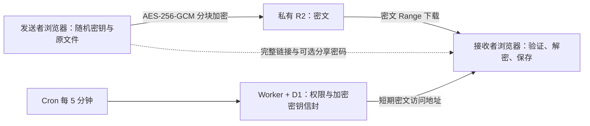

# Parcel Cloudflare 部署：密码 + TOTP、浏览器端到端加密

本文件维护当前上线的 **Workers + D1 + 私有 R2** 部署。管理员登录统一使用 **密码 + TOTP**。发送者浏览器先按 16 MiB 原文分块加密，再直传 R2；接收者下载密文，在浏览器验证、解密并流式保存。一个带 Static Assets 的 Worker 托管页面与 API，D1 保存权威状态，核心链路不依赖 Pi、Go、Tunnel 或内部 Origin。

新实例可按[中英图文教程](https://parcelwiki.pages.dev/zh)操作。独立 Go/SQLite 兼容代码使用原有协议，不支持本文件的 TOTP 与文件 E2EE；其维护资料见 [operations.md](operations.md)，不能混用凭据与文件恢复步骤。



## 浏览器端到端加密与升级

每个文件在上传者浏览器生成独立随机 32 字节文件密钥。每个 16 MiB 原文块采用 AES-256-GCM，前置新生成的 12 字节随机 nonce，尾部附 16 字节认证标签；因此完整密文块为 16,777,244 字节，末块按实际原文大小加 28 字节。空文件有一个 28 字节认证块。AAD 绑定协议版本、文件身份、总长度、块大小、块总数、块序号和当前原文长度，拒绝换块、乱序和截断。每次重试生成新 nonce，不复用旧尝试的随机值。最多 10,000 块，应用的 `MAX_FILE_BYTES` 仍可设置更低上限；默认单文件 8 GiB。

文件名、媒体类型、修改时间、原文 SHA-256 与文件密钥一起封装为 AES-GCM 密钥信封。分享链接的 `#k=…` 是随机 32 字节链接材料，URL 片段不随 HTTP 请求发送，客户端不得把它加入 API、审计或统计。无密码时，链接材料经 HKDF-SHA256 产生信封密钥；有密码时，再用独立随机盐的 Argon2id（32 MiB、2 次迭代、并行度 1）处理密码，与链接材料共同经 HKDF 派生信封密钥。盐、KDF 参数与不可变文件布局均受认证。服务器只保存公开描述与加密信封，没有明文文件密钥、原始文件名或原文哈希。

在线密码授权继续使用 `client-argon2id-v1`，但使用另一份随机盐与派生结果。它控制谁能取得密文访问地址，不是文件解密密钥；即使服务器能验证该凭据，也不能拿它解包文件密钥。`SESSION_SECRET` 继续保护服务端凭据、管理员 TOTP 与会话，不用于生成文件密钥。修改分享密码只重包信封并更新在线凭据，无需重传密文；执行修改的浏览器必须持有本机文件密钥或导入其加密备份。已经取得旧密钥与密文的人仍可解密已有副本，密码修改和撤销不能撤回这些材料。

上传前浏览器以有界内存读取整个原文件计算 SHA-256。暂停或刷新后，保留网站数据并重新选择原文件；再次核对完整哈希后只上传缺失块。浏览器本地记录含上传密钥；任务过期、清除网站数据或丢失该密钥会阻止恢复。分享创建者应保留完整链接，并通过“备份 / 导入本机分享密钥”导出加密 JSON 备份，使用独立的 12–256 字节口令。网站数据中的本机密钥并非防本机攻击的保险箱；备份、完整链接与本机密钥全部丢失时，服务器和管理员登录都无法恢复。

接收端按密文块 Range 获取、先验证 AEAD 再暂存 IndexedDB。完整接收后逐块再次验证、解密并流式写盘，最后核对密钥信封中的 SHA-256；不构建整文件 Blob。原生文件保存 API 可用时直接写入，否则使用同源 Service Worker 的有界流。刷新或中断从本机完整密文块恢复，同一有效下载会话不重复扣次。接收与保存通常同时需要一份密文缓存和一份原文件空间，约两倍文件大小并预留余量；浏览器存储配额、无痕模式、磁盘空间、下载权限及缓存驱逐都会影响可用容量。长期存储权限为可选项，拒绝或暂不回答不阻止本次接收。保存完成后用户可清理本机密文缓存。

服务器仍可见文件大小、分享 ID、有效期、次数与请求元信息。E2EE 信任实际加载的网页、浏览器与设备，不能抵抗恶意网页更新、扩展、本机恶意程序或已控制的端点。HTTPS、私有桶和 R2 静态加密继续作为额外保护。

正式部署先按序应用 `0004_e2ee.sql` 和 `0005_download_admissions.sql`，再发布 Worker。前者新增原文大小与加密描述列，保留原存储大小列作为配额权威账本；后者保存下载资格幂等记录的哈希，保证首次请求丢失响应、重试或并发不会重复扣除同一资格。迁移本身不删除或重写现有 D1/R2 文件；旧版未加密 Worker 分享不能在新协议下下载，返回不兼容状态，必须在浏览器重新加密上传。原有过期、撤销和清理生命周期仍适用。不要通过清空数据库或桶来升级。

无需新增服务端 E2EE Secret、环境变量或 CORS 请求头。保留完整 CORS 的 `Content-Type`、`Range`、`X-Amz-Meta-Parcel-Upload` 请求头，以及 `ETag`、`Content-Length`、`Content-Range`、`Accept-Ranges` 响应头暴露。Go 不认识加密对象和密钥信封，不能把这批分享导出后作为可读 Go 分享回滚；恢复旧 Worker 也不会自动把密文变成原文。独立 Go/Origin 构建的保留是部署模式保留，不是线上旧 Worker 分享兼容。

## 管理员密码 + TOTP 登录

部署模板和部署命令固定使用 **`ADMIN_AUTH=totp`**，运行时省略该变量也默认使用密码加 TOTP。前端构建使用 `VITE_ADMIN_AUTH=v3`，认证配置在运行时读取。新实例只需设置管理员密码、绑定认证器并保存恢复码。

### 首次绑定

1. 先完成下面的新实例资源、R2、运行时变量与三项长期 Secret 配置，保持 `ACTIVE=false`。部署脚本应用包括 `0003_admin_totp.sql` 在内的全部 D1 migrations。
2. 本机克隆仓库并使用 Node 24，执行 `npm run admin:setup-token`。随机初始化密钥保存到忽略文件 `.parcel-v3/admin-setup-token.txt`，不会打印，也不会覆盖已有文件。将文件内容保存为 Worker Secret `ADMIN_SETUP_TOKEN`，去掉末尾换行；保留原 `SESSION_SECRET`。
3. 打开应用 `/login`，输入初始化密钥，设置至少 12 位管理员密码。使用支持 TOTP 的认证器扫描页面绑定码，或手动导入密钥，输入 6 位动态码确认。二维码在浏览器本地生成，不经过第三方二维码服务。
4. 单独保存页面给出的 8 个恢复码，从 Worker Secrets 移除 `ADMIN_SETUP_TOKEN`。初始化密钥不能用于日常登录。
5. 用新的无痕窗口验证正确与错误凭据，以及匿名管理 API 401。确认后把 `ACTIVE=true` 并部署，再验收上传和加密分享。`ACTIVE=false` 时允许绑定和登录，文件传输与管理业务 API 仍返回维护状态。

### 日常登录与认证器恢复

日常登录使用管理员密码与动态码。认证器设备应自动同步时间；6 位动态码按 30 秒时间步更新，已用过的时间步不能重复登录。会话为 Secure / HttpOnly / SameSite=Strict 的主机 Cookie，12 小时到期；写操作检查 Origin 与会话 CSRF。登录与绑定有持久化限流。

管理页“登录安全”支持验证密码与当前动态码后更换认证器。手机丢失时，在登录页选择“无法使用认证器？使用恢复码”，输入密码与一个未使用的恢复码，再绑定新认证器。确认前不会获得管理员会话；完成后旧会话与旧恢复码失效，并生成新恢复码。取消或超时不消费恢复码；绑定须在 10 分钟内确认。

登录请求超时后，页面会检查是否已建立会话，提供进入管理页或重新登录的路径。不要连续提交同一个动态码。重置管理员或更换认证器都不能找回文件解密密钥。

### 无法使用密码与恢复码时

由持有目标 D1 管理权限的运维人员受控重置：先备份数据库与原 `SESSION_SECRET`，在 Worker 配置新的 `ADMIN_SETUP_TOKEN`，暂停其他初始化操作，再于目标 D1 Console 按顺序执行：

```sql
DELETE FROM admin_enrollments;
DELETE FROM admin_credentials WHERE id=1;
```

管理员会话与恢复码通过外键级联删除。该操作只清除管理员认证，不删除分享或 R2 对象，也不恢复文件密钥。随后重新打开 `/login` 绑定，保存新恢复码并移除初始化 Secret。

## 构建和验证

需要 Node 24。首次构建安装两个子项目的锁定依赖，后续可使用 `--skip-install`。

```bash
./scripts/build-v3.sh
npm run test:crypto
npm --prefix cloudflare run test:v3
npm --prefix cloudflare run test:browser:v3
PARCEL_LOGIN_WEB_DIR="$PWD/dist/v3-web" node --test web/tests/login-response.mjs
npm run test:e2ee:https
WRANGLER_SEND_METRICS=false node cloudflare/node_modules/wrangler/bin/wrangler.js deploy --dry-run --config wrangler.json
python3 -m unittest discover -s scripts/tests -p test_export_v3.py -v
```

前端构建在 `dist/v3-web/`；测试 Worker bundle 在 `dist/v3/`。不会覆盖 Go 内嵌的 `web/dist/` 或 Pages 产物。Cloudflare 部署测试运行真正的 workerd、D1 与 R2 bindings，S3 ListParts 接口和浏览器跨域传输用测试适配层连接到本地 R2；这些测试不能替代线上 R2 签名、CORS、密码 + TOTP 登录和 CPU 预算验收。

也可以先独立验证真实 R2 S3 签名，无需部署 Worker 或提供账户管理 Token：

```bash
npm run test:v3:r2-live -- --live \
  --endpoint https://ACCOUNT_ID.r2.cloudflarestorage.com --bucket BUCKET \
  --credentials-file .parcel-v3/cloudflare-credentials.json \
  --result .parcel-v3/r2-probe-result.json
```

需要先安装 `cloudflare/` 依赖。凭据文件须为 0600，支持部署用 JSON 或 Go 的 R2 凭据格式；也可省略文件参数，使用两个 R2 环境变量。工具在随机 `parcel/v3/probes/` 对象上验证 16 MiB + 3 字节上传、错误大小拒绝、ListParts、完成、中文文件名下载及 SHA-256，并在 `finally` 中终止 Multipart、删除对象和检查 HEAD 404。结果文件必须不存在，内容不含凭据或签名 URL。若清理失败，按输出的临时对象键清理遗留对象与 Multipart。这项测试使用 S3 API，不验证 Worker native binding、浏览器 CORS、管理员登录或 CPU。

## 新实例的资源与配置

### 部署按钮与绑定

准备 GitHub、Cloudflare 账户，启用 R2 与 Workers 子域名。套餐与付款设置由账户所有者完成。使用 README 的 Deploy to Cloudflare 按钮，默认资源名为 `parcel`，按实际情况创建 Worker、D1 和私有 R2。

Node 使用 **24**，根目录 `/`，构建命令 **`npm run build`**，部署命令 **`npm run deploy`**，关闭其他分支的预览构建。首次保持 `ACTIVE=false`。脚本通过 `DB` binding 应用全部迁移，写入真实 `R2_BUCKET_NAME`，并固定设置 `ADMIN_AUTH=totp`；保留其他控制台变量和 Secrets。配置完成前的 `serverless_unconfigured` 属于预期状态。

保留部署生成的绑定和命名空间：`DB` 对应 D1，`FILES` 对应私有 R2，`API_LIMITER` / `ADMIN_LIMITER` 是速率限制器，`ASSETS` 指向 `dist/v3-web/`。已有正式实例使用后面的专用生产命令。

### Worker 运行时变量

在 Worker → Settings → Variables and Secrets 的生产环境保存；这些不是构建变量。

| 名称                   | 类型        | 配置                                                         |
| ---------------------- | ----------- | ------------------------------------------------------------ |
| `ADMIN_AUTH`           | Variable    | **`totp`，模板和部署命令固定设置，省略也默认使用此模式**     |
| `PUBLIC_URL`           | Variable    | 实际 HTTPS origin，无路径、端口或尾部斜杠                    |
| `R2_ENDPOINT`          | Variable    | `https://YOUR_ACCOUNT_ID.r2.cloudflarestorage.com`，不带桶名 |
| `R2_BUCKET_NAME`       | Variable    | `FILES` 绑定的实际桶名                                       |
| `STORAGE_QUOTA_BYTES`  | Variable    | 新模板 `9000000000`，按密文和临时预留计量                    |
| `MAX_FILE_BYTES`       | Variable    | 默认 `8589934592`，即 8 GiB 原文件上限                       |
| `WORKERS_PLAN`         | Variable    | 未使用付费套餐时为 `free`                                    |
| `CLEANUP_BATCH_SIZE`   | Variable    | Free 为 `1`                                                  |
| `ACTIVE`               | Variable    | 初始化期间 `false`，完成绑定和登录验证后设为 `true` 并验收   |
| `SESSION_SECRET`       | Secret      | 独立随机 64 位十六进制值，长期保留并单独备份                 |
| `R2_ACCESS_KEY_ID`     | Secret      | 指定桶的 S3 Access Key ID                                    |
| `R2_SECRET_ACCESS_KEY` | Secret      | 配套 S3 Secret Access Key                                    |
| `ADMIN_SETUP_TOKEN`    | 临时 Secret | 首次绑定或受控重置时使用，绑定后移除                         |

S3 凭据选择目标桶的 **Object Read & Write**，不能用账户管理 API Token 替代。`SESSION_SECRET` 保护会话、管理员凭据、TOTP 种子与在线密码记录，不是文件解密密钥。丢失或直接替换会使现有认证材料无法解密；轮换前须使用旧密钥完成受控重新加密。

真实 Secret、数据库、上传文件与本机密钥备份不进入 Git、命令行参数、截图或聊天。资源标识与 Secret 分开保存。使用本机工具时，已有凭据文件 `.parcel-v3/cloudflare-credentials.json` 须保持受限权限；不要因换机器或更新代码生成替代的 `SESSION_SECRET`。

### CLI 首次部署

使用 Node 24 与 Bash，复制 `deploy/v3.example.json` 到忽略目录 `.parcel-v3/deploy.json`，填写账户 ID 与资源名，首次保持 `active:false`。配置只接受公开资源标识和数值限制；无需邮箱、组织或身份提供方配置。旧配置若含已废弃的管理员字段，脚本会要求使用当前示例整理后重试，在修改远端资源前停止。

把账户 API Token 保存为私有凭据文件 `.parcel-v3/cloudflare-credentials.json` 中的 `CLOUDFLARE_API_TOKEN`，或同名环境变量。该 Token 需要 Workers 脚本、D1 与 R2 管理权限，以及读取账户 Workers 子域名；R2 S3 凭据仍只授权目标桶。首次执行 `npm run admin:setup-token`，将文件内容作为 `ADMIN_SETUP_TOKEN` 加入私有凭据 JSON 或环境，去掉末尾换行，不能放在部署 JSON 的 `vars` 中。凭据文件使用 0600 权限，目录使用 0700，Windows 下应限制对应文件 ACL。

```bash
npm run deploy:bootstrap -- --config .parcel-v3/deploy.json --plan
npm run deploy:bootstrap -- --config .parcel-v3/deploy.json
```

脚本首次生成并私密保存 `SESSION_SECRET`，重复部署要求复用原值。若尚无 R2 S3 凭据，脚本在准备 D1、私有 R2、完整 CORS 与未完成上传清理规则后停止；创建桶范围凭据，将 `R2_ACCESS_KEY_ID` 与 `R2_SECRET_ACCESS_KEY` 加入私有凭据 JSON 或环境，再重试相同命令。资源状态记录在 `.parcel-v3/<Worker 名>/state.json`，须保留以便安全重试。默认拒绝接管未记录的现有数据库和桶；不要为绕过检查而随意开启 `allowExistingDatabase` 或 `allowExistingBucket`。

Worker 首次以维护状态发布，初始化密钥通过 Wrangler 标准输入保存为 Secret，不进入命令参数或生成的 Wrangler `vars`。打开该实例 `/login`，输入初始化密钥，设置密码并扫码绑定，保存恢复码。随后从 Worker 移除临时 `ADMIN_SETUP_TOKEN`，从本机凭据 JSON 或 CI Secret 同步移除该临时值，再运行：

```bash
npm run deploy:bootstrap -- --config .parcel-v3/deploy.json --activate
```

脚本检查 `/api/v1/auth-config` 确认密码加 TOTP 已完成绑定，才会开放服务；未完成绑定时保持维护状态并提示初始化。已记录成功部署的后续运行不会重新上传初始化密钥，也不会重置密码、TOTP 或恢复码。首次仅部署到该 Worker 自己的 workers.dev 地址，自定义域名在验收后按下文切换。

GitHub 手动部署工作流使用同一脚本。环境 `v3` 中保留原有 `PARCEL_V3_CONFIG`、`PARCEL_V3_SESSION_SECRET` 和两项 R2 Secret；首次另加 `PARCEL_ADMIN_SETUP_TOKEN` Secret，完成绑定后移除。首次不要勾选激活；第二次确认绑定后再激活。缓存只保存资源身份状态，不保存初始化密钥；普通生产更新使用下面的专用生产命令。

### R2 CORS 与生命周期

保持桶私有，不启用公开桶域名或 `r2.dev`。Origin 精确等于 `PUBLIC_URL`，可使用[教程配置工具](https://parcelwiki.pages.dev/zh#config)：

```json
[
  {
    "AllowedOrigins": ["https://parcel.example.com"],
    "AllowedMethods": ["GET", "HEAD", "PUT"],
    "AllowedHeaders": ["Content-Type", "Range", "X-Amz-Meta-Parcel-Upload"],
    "ExposeHeaders": [
      "ETag",
      "Content-Length",
      "Content-Range",
      "Accept-Ranges"
    ],
    "MaxAgeSeconds": 3600
  }
]
```

Object lifecycle rules 仅对 `parcel/v3/` 前缀设置未完成 Multipart 在 1 天后终止。不要按对象年龄独立删除已发布文件，正常删除由应用 Cron 与 D1 状态协调。保持 Cron `*/5 * * * *`；对象确认删除前继续计入配额。

完成管理员绑定和下面的真实上传、解密保存验收后，再设 `ACTIVE=true`。新实例默认 9 GB 应用配额不是账户账单硬上限，R2 免费额度按账户共享。

### 加密分享操作

1. 登录后选择文件，设置可选分享密码、有效期与次数。浏览器先核对完整 SHA-256，再按块加密上传。暂停、刷新后保留网站数据，重新选择原文件并核对完整哈希，只继续缺失块。
2. 分享包含 `#k=…` 的完整链接，可选密码分开发送。换设备或清理网站数据前导出加密 JSON 密钥备份，使用独立的 12–256 UTF-8 字节口令；新浏览器管理分享密码前先导入。
3. 接收者用完整链接和可选密码在本机解包密钥，验证密文并暂存 IndexedDB。接收完成后点“保存解密文件”，逐块验证、解密、流式写盘并核对完整 SHA-256；保存期间保持页面打开，确认结果后可清除缓存。
4. 修改分享密码只重包密钥信封，不重传文件。下载次数表示获准传输的资格，不是成功保存次数或独立人数；同一有效会话重试、续传和续签不重复扣次，网络中断不退还资格。

大文件通常需要同时容纳密文缓存与最终文件，约两倍文件大小并预留余量，还须满足浏览器配额。无痕模式、下载权限、缓存驱逐和设备磁盘都会限制可用容量。算法按块处理不代表所有设备均可接收 8 GiB。

完整链接、本机密钥与可用备份全部丢失时，服务器无法恢复。管理员认证、恢复码和 `SESSION_SECRET` 均不能代替文件密钥。

## 从现有 Go 或旧 Worker 升级

新版 Cloudflare 部署不保留未加密分享的下载兼容。历史 Go→D1 的数据库导入只能搬运状态，不能把原文对象变为 E2EE 密文；不要用旧导入流程宣称旧分享可继续访问。需保留原文件时，先从原实例另行保存，再在新版浏览器重新加密上传，生成新链接。升级到新 Cloudflare 部署的现有旧分享返回不兼容状态；迁移本身不清空或删除数据库与桶。

建议使用独立资源验收，并备份旧数据库、对象、配置与二进制。两套后端不得同时写入或清理同一对象前缀。独立 Go 可继续运行其原模式，但它不支持新版 Cloudflare 部署的密文与密钥信封。原管理员与旧分享的服务端凭据备份，也不能代替浏览器文件密钥备份。

## 正式域名切换

先完成隔离环境验收，再转移正式域名。旧分享不能直接转成新版加密分享，需要保存原文件并重新上传；使用独立新桶切换时，旧后端仍只管理旧桶。

1. 准备正式 Wrangler 配置：复用已验证的 Worker、D1、私有 R2 与 Secrets；把 `PUBLIC_URL` 改为正式 HTTPS 地址，设置 `workers_dev:false`、`preview_urls:false`。明确保留 `ADMIN_AUTH=totp`，使用应用自己的密码与动态码登录。R2 CORS 加入正式来源，同时保留旧来源与无关规则。
2. 在 Dashboard 的原 Pages 项目 → 自定义域，解除正式域名绑定；然后在 Worker → 设置 → 域和路由 → 添加 → 自定义域，填写同一域名。若旧 Pages CNAME 阻止绑定，只移除该主机名的旧记录，再由 Worker 创建记录。保留 Origin 域名与其他 DNS。这两个界面之间可能短暂中断，因此应在配置和回滚方案准备好后操作。
3. 部署已审阅的正式配置。通过 Dashboard 管理自定义域时，配置可以省略 `routes`；Wrangler 在没有 custom-domain routes 时不会重写已绑定的自定义域。由 CLI 创建/修改自定义域则还需要该 Zone 的 Workers Routes Write 权限。[Workers 权限](https://developers.cloudflare.com/workers/authorization/workers/)
4. 验证正式域名显示密码 + TOTP 登录，匿名管理 API 拒绝访问，公开加密分享可打开；完成分块上传、解密保存、密码、下载续签、撤销、Cron 和实际 CPU 验收。确认 `workers.dev` 已关闭，再记录切换时间与资源配置。确认公开分享与管理员登录均通过实际应用路由访问。

若切换验收失败，应先维护并保留 D1、R2 和客户端密钥备份，再按已验证的资源隔离方案恢复访问。禁止让两套后端同时写入或清理同一对象；不能把旧 Go 指向新 Cloudflare 部署的密文来恢复下载。正式切换后使用生产更新命令，不重跑首次资源准备流程。

## 回滚

新版 E2EE 分享不能导出为 Go 可读分享，历史 `export-d1-v3.mjs` / `rollback-v3.py` 流程不支持它们。不能恢复旧 SQLite、指向同一密文桶就声称完成回滚，也不能用服务端 `SESSION_SECRET` 解密文件。

应用发布失败时优先修复并重新部署兼容 E2EE 的 Worker。若确需恢复旧服务，先维护新版、保存一致的 D1/R2 与客户端密钥备份，停止新版清理与写入，再恢复与原服务对应的独立数据库和对象。新 E2EE 文件保留在独立备份或兼容的 Cloudflare 部署实例中，不能由 Go 接管。数据库恢复、次数、撤销与对象清理状态必须一致；禁止两套清理器同时管理同一前缀。

## 清理、备份和容量

Cron 每 5 分钟恢复未完成发布、处理闲置任务、清理过期/撤销/下载次数耗尽的分享。Free 默认每次最多处理一个上传任务和一个分享，过期会话、授权和审计各表每次删除最多 100 条。积压会留待后续执行，对象删除确认前继续计入配额。Paid 可配置 `CLEANUP_BATCH_SIZE` 为 1–30，Free 固定为 1，避免一次 Cron 扫描与清理过多。默认分享最长 7 天、下载会话最长 8 小时、签名 URL 5 分钟。对象至少保留到 `signed_until`，远程删除确认后才释放 D1 配额。没有 URL 即时撤销能力，已签发 URL 在短有效期内仍可能可用。[R2 预签名 URL](https://developers.cloudflare.com/r2/api/s3/presigned-urls/)

新模板配额默认 9 GB、单文件默认 8 GiB；已有实例以运行时变量为准。这是应用保护额度，不是 Cloudflare 账单硬上限。R2 免费额度与操作次数按账户共享，可调低 `STORAGE_QUOTA_BYTES` 并为其他桶、未完成 Multipart 和清理积压预留空间。额度与计费以账户控制台及当前 [R2 价格说明](https://developers.cloudflare.com/r2/pricing/)为准。

所有状态事务走 D1 主库，下载计数及容量预留不依赖 KV 或只读副本。`batch()` 的事务和 SQL 触发器使计数、授权和额度一起提交。[D1 API](https://developers.cloudflare.com/d1/worker-api/d1-database/)

R2 生命周期规则只终止遗留的未完成 `parcel/v3/` Multipart，不按对象年龄删除已发布文件，避免绕过会话保留期。长时间持续上传仍须在该生命周期截止前完成；默认任务与规则时间窗口约一天。应用 Cron 和生命周期不能保证立刻回收空间，应监测失败任务和实际桶容量。

在生成正式构建配置后执行 D1 导出，每次使用新的备份文件名。导出只备份数据库，不是 R2 或浏览器密钥备份；业务切换仍需一致的冻结快照：

```bash
node cloudflare/node_modules/wrangler/bin/wrangler.js d1 export DB --remote --config .parcel-v3/wrangler.builds.json --output .parcel-v3/backup.sql
```

D1 快照不是 R2 文件备份；对象删除与数据库恢复必须一起考虑。保留对象备份或明确可接受的临时文件丢失窗口。审计元数据保留 30 天，过期会话/授权/限流计数由 Cron 清理。部署状态和 Secrets 另行加密备份。

## CI 与发布入口

普通 CI 验证 Cloudflare 部署构建、Wrangler dry-run、workerd/D1/R2、迁移、加密核心、真实 HTTPS 浏览器传输与登录响应恢复。真实 HTTPS 套件使用 Linux、Node 24、OpenSSL、NSS `certutil`、Playwright 浏览器与本地 D1/R2 夹具。8 GiB 完整验收使用 `PARCEL_E2EE_LARGE=1 npm run test:e2ee:https` 显式启用，需要多份文件空间和较长时间；详见[协议验收说明](e2ee-protocol.md#acceptance)。本地测试不能代替线上 CORS、签名、CPU 与实际设备验收。

仓库 `main` 提供 MIT 开源源码与 Deploy to Cloudflare 入口。新实例使用部署按钮和本文件的 TOTP 初始化流程；已有实例使用下面的生产构建与部署命令，保留原资源和 Secrets。

## 正式 Worker 的 Git 自动部署

正式 Worker 连接 `main` 生产分支。在 Workers 的 Settings > Builds 中选择仓库、生产分支，关闭其他分支自动构建，根目录保持仓库根目录，使用 Node 24：

正式实例在 Cloudflare Builds 中连接仓库的 `main` 生产分支，使用以下命令。新实例的按钮构建与已运行实例的生产构建是两个阶段，不能直接照抄未准备资源的配置。

- 构建命令：`npm run build:production`
- 部署命令：`npm run deploy:production`
- 构建变量：`PARCEL_WORKER_BUILD_CONFIG`，JSON 对象，仅包含 `accountId`、`workerName`、`databaseId`、`databaseName`、`bucketName`，填写已上线实例的资源标识。
- 构建变量：`NODE_VERSION=24`。

`PARCEL_WORKER_BUILD_CONFIG` 的 JSON 结构如下；所有占位值都须换成已存在的真实资源标识，不包含任何 Secret：

```json
{
  "accountId": "YOUR_ACCOUNT_ID",
  "workerName": "parcel",
  "databaseId": "YOUR_DATABASE_UUID",
  "databaseName": "parcel",
  "bucketName": "parcel"
}
```

`build:production` 先验证资源标识、生成忽略目录中的 `.parcel-v3/wrangler.builds.json`，然后安装锁定依赖并构建前端与 Worker。`deploy:production` 固定写入 `ADMIN_AUTH=totp`，其余运行时变量与 Secrets 保留，关闭 workers.dev 和预览地址，不上传仓库示例变量，不自动创建数据库或存储桶，不更改域名及 R2 CORS。切换到这套关闭 workers.dev 的生产命令前，应已完成管理员绑定，并已验收正式自定义域。账户配置与凭据继续留在本机或 Cloudflare，不提交到 Git。

Cloudflare 构建的 API Token 使用已拥有的部署 Token，或另行配置受限用户 Token。自动数据库迁移需要当前账户的 D1 编辑权限；还需要 Workers 脚本编辑、Workers R2 存储读取及账户设置读取。若原 Token 只有 D1 读取权限，需一次性补充 D1 编辑权限；构建与部署命令、资源标识和运行时变量无需改动。Workers 脚本权限覆盖所选账户的 Workers，不能按单个 Worker 限定。

只有所选生产分支触发正式部署；其他分支继续由 GitHub CI 检查。Cloudflare 构建与 GitHub CI 分别运行；推送生产分支前应完成相关测试。`deploy:production` 现在先对现有 DB binding 执行未应用的 D1 migrations，成功后才发布 Worker；迁移失败会阻止发布，修复后可重试同一命令，已完成的迁移不会重复执行。新增迁移须兼容部署期间仍运行的旧 Worker，并在推送前审阅数据与回滚影响。

“不限下载次数”使用 `max_downloads=-1`，`1–100` 为有限次数，省略或传 `0` 使用默认次数，不需要新增环境变量。新实例按序应用全部迁移，已有实例只应用未完成项；有效期、密码、撤销与清理语义保持一致。生产恢复只使用支持当前 E2EE 协议与 schema 的 Worker，不能把新版密文与快照交给 Go 接管。

## 教程截图更新清单

[中英图文教程](https://parcelwiki.pages.dev) 统一使用管理员密码 + TOTP，保留六张 Cloudflare 配置图：`bindings.webp`、`template-build.webp`、`r2-token.webp`、`add-secret.webp`、`r2-cors.webp`、`builds.webp`。运行时变量由配置工具固定生成 `ADMIN_AUTH=totp`；旧认证步骤及包含废弃字段的变量截图已撤下。E2EE 无新增环境变量、服务端文件密钥或 CORS 请求头。构建成功详情与 CORS 图已使用 2026-10-20 的截图更新，TOTP 绑定示意保留，不需要真实扫码截图。

需要更新或新增的应用侧截图是：上传创建与本机哈希/加密进度、成功页完整链接提示、分享详情的密码修改与加密密钥备份、接收页密码解锁、密文接收/暂停/续传、解密保存与本机缓存清理。只使用可丢弃演示文件和密钥；公开图片必须遮住真实 `#k=…`、分享密码、备份口令/内容、TOTP 和恢复码。原理图继续使用网页绘制，不把真实密钥截图用作说明。

推送后确认 Cloudflare 构建与部署成功，并检查网页资源、密码 + TOTP 登录流程，以及登录后的 `/api/v1/admin/status`。Worker 没有 Go 服务的 `/readyz` 路由。需要回滚时仅选择支持相同 E2EE 协议和数据库 schema 的 Worker 版本，随后回退对应 Git 提交，避免下次推送重新发布故障版本。回退到旧的未加密 Worker 不能恢复新版加密分享的可用性；保留 D1/R2 备份与兼容的恢复版本。

## 本机执行正式更新

使用 Node 24、Bash、已授权的 Wrangler 会话或目标账户部署 Token。把上节真实资源标识 JSON 设为环境变量 `PARCEL_WORKER_BUILD_CONFIG`，从仓库根目录执行：

```bash
npm run build:production
npm run deploy:production
```

只用于资源、域名、运行时配置和管理员均已准备好的正式实例。构建不会初始化管理员或替换 Secrets。正常更新无需重新绑定 TOTP；迁移失败时修复权限或数据库问题，再重试同一命令。Worker 发布失败也不自动回退数据库。

## 上线验收清单

1. 无痕窗口进入 `/admin`，显示密码 + TOTP 登录。错误凭据失败，匿名管理 API 返回 401；登录后 `/api/v1/admin/status` 正常，退出后不能管理。
2. 上传空文件、小文件和超过 16 MiB 的文件，测试有密码、无密码及不限次数分享。暂停、刷新、重新选择原文件核对哈希后续传。
3. 未登录窗口打开完整链接，测试缺少片段、错误密码和正确密码；接收密文、刷新续传、解密保存，最终 SHA-256 与原文件一致。
4. 导出并导入加密密钥备份，修改密码而不重传文件；首次资格响应丢失后的重试及同会话续签不重复扣次。
5. 确认 R2 仅保存密文，D1 无原始文件名或明文文件密钥，API 与审计不含 `#k=…`。核对撤销、到期、Cron、实际 CPU 及对象删除后的配额释放。

当前验收的实际范围见 [v3-plan.md](v3-plan.md)。本地 8 GiB 夹具验收不能写成线上 R2 的 8 GiB 验收。
