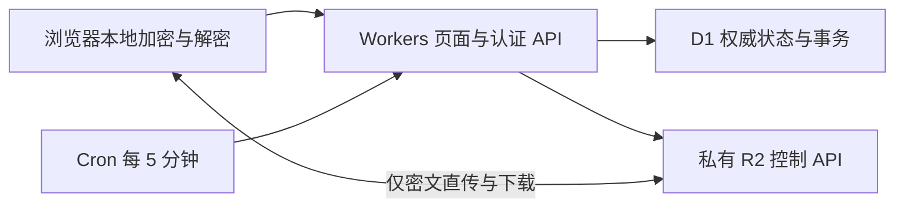

# V3：Workers + D1 + 私有 R2

V3 的页面和 API 由一个带 Static Assets 的 Worker 托管；D1 是分享、上传任务、下载会话和配额的唯一权威数据库。浏览器先按 16 MiB 原文分块加密，再用 Multipart 直传 R2；下载短期签名地址返回密文，由接收者浏览器解密保存。管理员可使用密码 + TOTP，或继续使用 Cloudflare Access；Worker 校验会话或 Access JWT，并验证 Origin 和 CSRF。树莓派、Go、SQLite、Tunnel 和内部 Origin 服务令牌退出这条请求链路。文件端到端加密仅用于 Cloudflare V3：独立 Go 与连接 Origin 的 Pages 构建保留原 UI 和传输协议，未提供 E2EE。



## V3 端到端加密与升级

每个文件在上传者浏览器生成独立随机 32 字节文件密钥。每个 16 MiB 原文块采用 AES-256-GCM，前置新生成的 12 字节随机 nonce，尾部附 16 字节认证标签；因此完整密文块为 16,777,244 字节，末块按实际原文大小加 28 字节。空文件有一个 28 字节认证块。AAD 绑定协议版本、文件身份、总长度、块大小、块总数、块序号和当前原文长度，拒绝换块、乱序和截断。每次重试生成新 nonce，不复用旧尝试的随机值。最多 10,000 块，应用的 `MAX_FILE_BYTES` 仍可设置更低上限；默认单文件 8 GiB。

文件名、媒体类型、修改时间、原文 SHA-256 与文件密钥一起封装为 AES-GCM 密钥信封。分享链接的 `#k=…` 是随机 32 字节链接材料，URL 片段不随 HTTP 请求发送，客户端不得把它加入 API、审计或统计。无密码时，链接材料经 HKDF-SHA256 产生信封密钥；有密码时，再用独立随机盐的 Argon2id（32 MiB、2 次迭代、并行度 1）处理密码，与链接材料共同经 HKDF 派生信封密钥。盐、KDF 参数与不可变文件布局均受认证。服务器只保存公开描述与加密信封，没有明文文件密钥、原始文件名或原文哈希。

在线密码授权继续使用 `client-argon2id-v1`，但使用另一份随机盐与派生结果。它控制谁能取得密文访问地址，不是文件解密密钥；即使服务器能验证该凭据，也不能拿它解包文件密钥。`SESSION_SECRET` 继续保护服务端凭据、管理员 TOTP 与会话，不用于生成文件密钥。修改分享密码只重包信封并更新在线凭据，无需重传密文；执行修改的浏览器必须持有本机文件密钥或导入其加密备份。已经取得旧密钥与密文的人仍可解密已有副本，密码修改和撤销不能撤回这些材料。

上传前浏览器以有界内存读取整个原文件计算 SHA-256。暂停或刷新后，保留网站数据并重新选择原文件；再次核对完整哈希后只上传缺失块。浏览器本地记录含上传密钥；任务过期、清除网站数据或丢失该密钥会阻止恢复。分享创建者应保留完整链接，并通过“备份 / 导入本机分享密钥”导出加密 JSON 备份，使用独立的 12–256 字节口令。网站数据中的本机密钥并非防本机攻击的保险箱；备份、完整链接与本机密钥全部丢失时，服务器和管理员登录都无法恢复。

接收端按密文块 Range 获取、先验证 AEAD 再暂存 IndexedDB。完整接收后逐块再次验证、解密并流式写盘，最后核对密钥信封中的 SHA-256；不构建整文件 Blob。原生文件保存 API 可用时直接写入，否则使用同源 Service Worker 的有界流。刷新或中断从本机完整密文块恢复，同一有效下载会话不重复扣次。接收与保存通常同时需要一份密文缓存和一份原文件空间，约两倍文件大小并预留余量；浏览器存储配额、无痕模式、磁盘空间、下载权限及缓存驱逐都会影响可用容量。长期存储权限为可选项，拒绝或暂不回答不阻止本次接收。保存完成后用户可清理本机密文缓存。

服务器仍可见文件大小、分享 ID、有效期、次数与请求元信息。E2EE 信任实际加载的网页、浏览器与设备，不能抵抗恶意网页更新、扩展、本机恶意程序或已控制的端点。HTTPS、私有桶和 R2 静态加密继续作为额外保护。

正式部署先按序应用 `0004_e2ee.sql` 和 `0005_download_admissions.sql`，再发布 Worker。前者新增原文大小与加密描述列，保留原存储大小列作为配额权威账本；后者保存下载资格幂等记录的哈希，保证首次请求丢失响应、重试或并发不会重复扣除同一资格。迁移本身不删除或重写现有 D1/R2 文件；旧版未加密 V3 分享不能在新协议下下载，返回不兼容状态，必须在浏览器重新加密上传。原有过期、撤销和清理生命周期仍适用。不要通过清空数据库或桶来升级。

无需新增服务端 E2EE Secret、环境变量或 CORS 请求头。保留完整 CORS 的 `Content-Type`、`Range`、`X-Amz-Meta-Parcel-Upload` 请求头，以及 `ETag`、`Content-Length`、`Content-Range`、`Accept-Ranges` 响应头暴露。Go 不认识加密对象和密钥信封，不能把这批分享导出后作为可读 Go 分享回滚；恢复旧 Worker 也不会自动把密文变成原文。独立 Go/Origin 构建的保留是部署模式保留，不是线上旧 V3 分享兼容。

## 管理员密码 + TOTP 登录（替代邮箱验证码）

V3 支持 `ADMIN_AUTH=totp`，由 Parcel 验证管理员密码与认证器动态码，无需管理员邮箱或 Access JWT。未设置该变量时继续使用原 Access 登录，已有实例升级后不会自动切换。此功能适用于 Workers + D1 的 V3；Go 和旧 Pages 网关保留原认证方式。前端 V3 构建使用 `VITE_ADMIN_AUTH=v3`，在运行时读取认证模式，无需为两种模式分别构建。

现有正式实例在 Cloudflare Dashboard 中按以下顺序切换：

1. 发布本次代码。正式 `deploy:production` 会先应用 `0003_admin_totp.sql`，新增管理员凭据、会话、绑定和恢复码表，不改动分享与 R2 数据。构建命令、D1/R2 bindings、域名、CORS 和现有存储配置无需调整。
2. 本机执行 `npm run admin:setup-token`，生成 `.parcel-v3/admin-setup-token.txt`（忽略提交，拒绝覆盖）。在 Worker → Settings → Variables and Secrets 中新增 **Secret** `ADMIN_SETUP_TOKEN`，粘贴文件内容并去掉末尾换行；新增普通变量 **`ADMIN_AUTH=totp`**，保存并部署。不得替换原 `SESSION_SECRET`，它还保护已有密码分享与新的 TOTP 密钥。
3. 打开正式 `/login`。首次设置需要初始化密钥、至少 12 位管理员密码及确认密码；扫码导入 Google Authenticator、Microsoft Authenticator、1Password 等支持 TOTP 的认证器，也可手动输入密钥。输入生成的 6 位动态码完成绑定，再下载并妥善保存 8 个恢复码。初始化密钥在管理员建立后不能再次初始化或登录；可从 Worker Secrets 删除 `ADMIN_SETUP_TOKEN`，常规登录和重新绑定不依赖它。
4. 在 Zero Trust → Access controls → Applications 中找到**只保护 Parcel 管理入口的管理员应用**（例如 `parcel-admin`）。确认没有其他用途后移除该应用，或移除其中 Parcel 的七个管理路径：`/login`、`/admin`、`/admin/*`、`/api/v1/auth/*`、`/api/v1/admin/*`、`/api/v1/uploads`、`/api/v1/uploads/*`。如果另有更宽泛的 Access 应用覆盖同一域名，也须解除对这些管理路径的拦截。只修改 Parcel 管理员应用，保留其他服务及旧 Origin 的 Service Auth 应用。
5. 使用新的无痕窗口验证：管理页面直接显示 Parcel 密码与动态码表单，不再跳转邮箱；匿名管理 API 返回 401；密码或动态码错误均不能登录；正确登录可上传、管理与退出；公开分享仍可正常下载。移除 Access 前，其已有邮箱认证仍会挡在 Parcel 登录页之前，因此可先在已验证的 Access 会话中完成绑定，再移除入口保护。

部署仍保留原运行时变量与 Secrets。切换后 `ACCESS_TEAM_DOMAIN`、`ACCESS_AUD`、`ADMIN_EMAILS` 不再参与 V3 认证，可保留以便切回 Access。后续使用正式 `build:production` / `deploy:production`，不要对既有正式实例重跑面向新 Access 资源的 `deploy:bootstrap`。

正常登录使用“密码 + 动态码”。管理页“登录安全”支持验证密码与当前动态码后更换认证器。手机丢失时，在登录页选择“无法使用认证器？使用恢复码”，输入密码和一个未使用的恢复码，再绑定新认证器。恢复流程完成前不会获得管理员会话；确认后一次性消费旧恢复码，撤销所有旧会话和其余旧恢复码，生成一套新的恢复码。取消或超时不会消费恢复码，也不会更改当前认证器。初始绑定及重新绑定均须在 10 分钟内确认。

TOTP 使用 [RFC 6238](https://www.rfc-editor.org/rfc/rfc6238) 的 SHA-1、6 位、30 秒时间步，容忍前后一个时间步；D1 原子记录已使用时间步，拒绝并发和重复使用。管理员密码沿用浏览器 Argon2id 与服务端加密校验，TOTP 密钥使用独立域派生的 AES-GCM 密钥加密。会话为 Secure / HttpOnly / SameSite=Strict 的主机 Cookie，12 小时到期，写操作校验 Origin 和每个会话独立的 CSRF。登录与绑定另有持久化的按 IP 和全局限流，不因 Worker 重启清空。二维码在浏览器本地生成，密钥不发往第三方服务。不要记录认证请求正文、二维码或恢复码。

如果遗忘密码，或手机与所有恢复码均丢失，只能由有该实例 D1 管理权限的运维人员执行重置：先在 Cloudflare 配置一个新的 `ADMIN_SETUP_TOKEN`，再于目标 D1 Console 按顺序执行下面两条语句，随后重新打开 `/login` 初始化。该操作仅清除管理员认证，不动分享与对象；会立刻撤销所有管理员会话。

```sql
DELETE FROM admin_enrollments;
DELETE FROM admin_credentials WHERE id=1;
```

`admin_sessions` 和 `admin_recovery_codes` 通过外键级联删除。不要在重置期间继续初始化或登录。数据库备份包含加密后的认证密钥和凭据，须与 `SESSION_SECRET` 分开妥善备份。

回退时，先恢复覆盖全部管理路径的管理员 Access 应用及白名单，确认 Access 能正常验证，再把 `ADMIN_AUTH` 改回 `access` 并核对原三项 Access 变量。新增表可保留；切回 `totp` 会恢复原凭据，除非已执行重置。

## 构建和验证

需要 Node 24。首次构建安装两个子项目的锁定依赖，后续可使用 `--skip-install`。

```bash
./scripts/build-v3.sh
npm --prefix cloudflare run test:v3
npm --prefix cloudflare run test:browser:v3
WRANGLER_SEND_METRICS=false node cloudflare/node_modules/wrangler/bin/wrangler.js deploy --dry-run --config wrangler.json
python3 -m unittest discover -s scripts/tests -p test_export_v3.py -v
```

前端构建在 `dist/v3-web/`；测试 Worker bundle 在 `dist/v3/`。不会覆盖 Go 内嵌的 `web/dist/` 或 Pages 产物。V3 测试运行真正的 workerd、D1 与 R2 bindings，S3 ListParts 接口和浏览器跨域传输用测试适配层连接到本地 R2；这些测试不能替代线上 R2 签名、CORS、Access 登录和 CPU 预算验收。

也可以先独立验证真实 R2 S3 签名，无需部署 Worker 或提供账户管理 Token：

```bash
npm run test:v3:r2-live -- --live \
  --endpoint https://ACCOUNT_ID.r2.cloudflarestorage.com --bucket BUCKET \
  --credentials-file .parcel-v3/cloudflare-credentials.json \
  --result .parcel-v3/r2-probe-result.json
```

需要先安装 `cloudflare/` 依赖。凭据文件须为 0600，支持部署用 JSON 或 Go 的 R2 凭据格式；也可省略文件参数，使用两个 R2 环境变量。工具在随机 `parcel/v3/probes/` 对象上验证 16 MiB + 3 字节上传、错误大小拒绝、ListParts、完成、中文文件名下载及 SHA-256，并在 `finally` 中终止 Multipart、删除对象和检查 HEAD 404。结果文件必须不存在，内容不含凭据或签名 URL。若清理失败，按输出的临时对象键清理遗留对象与 Multipart。这项测试使用 S3 API，不验证 Worker native binding、浏览器 CORS、Access 或 CPU。

## 一次性账户准备

账户须已启用 R2、建立 Zero Trust 组织及 Workers 子域名。V3 默认支持 Workers Free，不需要订阅 Workers Paid。密码保护仍使用与 Go 一样的 Argon2id：32 MiB、2 次迭代、并行度 1；浏览器在独立 Web Worker 中计算，Cloudflare Worker 只执行原生 Web Crypto 加密和校验。Free 每次 HTTP 请求和 Cron 的 CPU 预算为 10 ms，生产环境仍须验证请求表现，不能用本地墙钟耗时代替 CPU 数据。[Workers 限制](https://developers.cloudflare.com/workers/platform/limits/)

密码接口协商 `client-argon2id-v1` 协议。创建与修改密码使用随机 16 字节盐，解锁使用公开的同一盐与固定参数，提交派生结果而非明文密码。D1 中的派生结果以 AES-GCM 加密，密钥由 `SESSION_SECRET` 单独域派生；KDF 参数和盐也经过认证。数据库记录无法直接作为解锁凭据重放。派生结果在传输中具有凭据性质，必须全程 HTTPS，禁止记录请求正文、在浏览器持久存储派生结果或把密码放入 URL。管理员授权、限流、版本失效与下载会话计数仍由服务端执行。Go 模式继续使用原明文密码接口。

`SESSION_SECRET` 同时保护会话与加密密码记录，必须长期保存并单独加密备份。丢失或直接替换会导致现有密码分享无法解锁；轮换前必须用旧密钥完成受控重新加密。将存储的密码哈希额外加密、密钥独立于数据库保存，符合密码存储加密的设计原则，但这里不声称整套应用获得标准认证。[NIST 密码存储指导](https://pages.nist.gov/800-63-4/sp800-63b.html)

准备一个仅限目标账户的管理 API Token，权限包括 Workers Scripts Edit、D1 Edit、Workers R2 Storage Write、Access Apps and Policies Write、Access Organizations Read、Access Identity Providers Read/Write；若控制台要求读取权限，补上对应 Read。R2 S3 Token 使用目标桶的 Object Read & Write。管理 Token 与 S3 Token 分开，不能把前者当作后者。

从 [deploy/v3.example.json](../deploy/v3.example.json) 复制配置到忽略目录 `.parcel-v3/deploy.json`，填写账户 ID 和管理员邮箱。`workersPaid:false` 为 Free 默认值；只有已订阅 Paid 的账户才设为 `true`，届时工具会增加 30 秒 CPU 上限和较大的清理批次。工具不会开通或更改套餐。默认创建名为 `parcel` 的 Worker、D1 和私有桶，并保持维护模式。新桶可以通过账户管理 Token 自动创建；S3 凭据须能访问指定桶。只有管理 Token 时，首次命令先创建隔离资源，保存可恢复的状态后停止；此时可在 Dashboard 为刚创建的桶生成限定桶的 S3 Token，填写凭据，再执行同一条命令完成部署。不会为避免这一步而要求覆盖所有桶的 S3 权限。已有 D1 须匹配保存的数据库 ID，或明确设置 `allowExistingDatabase:true` 后复用。已有桶必须明确设置 `allowExistingBucket:true`，并保证没有另一套后端正在写入/清理其中的相同对象。

通过本机环境或受保护的 CI Secrets 提供：

- `CLOUDFLARE_API_TOKEN`：账户管理 Token。
- `R2_ACCESS_KEY_ID`、`R2_SECRET_ACCESS_KEY`：目标桶的 S3 凭据。
- `SESSION_SECRET`：可选的 64 位十六进制密钥。本机首次部署自动生成并保存；CI 必须配置长期不变的值。

本机四项密钥统一保存在 `.parcel-v3/cloudflare-credentials.json`（0600，目录 0700，忽略提交）。部署、导入、导出和 R2 探测通过 `scripts/v3-credentials.mjs` 读取；环境变量优先于文件，覆盖 R2 凭据时须同时提供两个字段。首次部署生成的 `SESSION_SECRET` 也写入此文件，不再生成 `.parcel-v3/<name>/secrets.json`；环境变量提供的密钥不会被写回文件。已有实例缺少原 `SESSION_SECRET` 时拒绝自动生成替代密钥。旧 `secrets.json` 必须先将原值收拢至统一文件，确认一致后再删除。

不要把真实值写在命令行参数、Git 文件或聊天中。部署资源状态保存在 `.parcel-v3/<name>/state.json`，与密钥分开。换开发机器时通过 SSH 或加密备份迁移统一密钥文件、所用的正式 Wrangler 配置及状态；实例私有记录 `docs/v3-configuration.md` 被 Git 忽略，也须单独迁移。截图按需迁移，构建产物和依赖在新机器重新生成。迁移开发机器不需要复制远程 D1/R2 数据，也不需要重建 Cloudflare 资源。

## 单条部署命令

```bash
npm run deploy -- --config .parcel-v3/deploy.json --plan
npm run deploy -- --config .parcel-v3/deploy.json
```

`--plan` 只显示计划，完全不访问账户、不创建资源。实际命令先构建，然后复用/创建 D1 和私有 R2，合并专属 CORS 及 Multipart 终止规则，建立独立的管理员 Access 应用，应用数据库迁移，部署维护模式 Worker，通过标准输入上传 Secrets，最后进行公共 API 探测。中断后执行同一条命令可继续；已有无关 R2 规则保留。已有同名 Access 应用必须匹配保存的资源 ID，状态丢失时可把审阅过的 `accessAppId` 写入部署配置。默认不迁移旧域名，不覆盖原 Pages 或 Origin。

管理员 Access 应用覆盖 `/login`、`/admin`、`/admin/*`、`/api/v1/auth/*`、`/api/v1/admin/*`、`/api/v1/uploads`、`/api/v1/uploads/*`，仅允许配置邮箱。分享 `/s/*`、公共分享 API 和静态资源保持可访问。无身份提供商时创建邮件一次性验证码提供商，已有提供商保持原样。[Access API](https://developers.cloudflare.com/api/resources/zero_trust/subresources/access/subresources/applications/methods/create/)

首次使用独立桶、不迁移旧分享，可以在验证配置后激活：

```bash
npm run deploy -- --config .parcel-v3/deploy.json --activate
```

上线验收需按所选方式登录，上传 0 字节、小文件和超过 16 MiB 的文件；验证暂停、刷新、原文件全哈希核对和续传，缺少 `#k=…`、错误密码和正确密码的接收行为，加密密钥备份导入、密码修改、密文 Range 续传与撤销。接收后流式保存并比对原文件 SHA-256；确认 R2 仅有密文、D1 无原始文件名或明文密钥，Network 没有 Pi/Origin 请求，首次下载资格丢响应重试及同一有效会话续签不重复扣次。查看 Workers 实际 CPU、异常及 Cron 执行记录，并确认密文字节配额恢复。自动公共探测不能代替这些验收。

## 从现有 Go 或旧 V3 升级

新版 V3 不保留未加密分享的下载兼容。历史 Go→D1 的数据库导入只能搬运状态，不能把原文对象变为 E2EE 密文；不要用旧导入流程宣称旧分享可继续访问。需保留原文件时，先从原实例另行保存，再在新版浏览器重新加密上传，生成新链接。升级到新 V3 的现有旧分享返回不兼容状态；迁移本身不清空或删除数据库与桶。

建议使用独立资源验收，并备份旧数据库、对象、配置与二进制。两套后端不得同时写入或清理同一对象前缀。独立 Go 可继续运行其原模式，但它不支持新版 V3 密文与密钥信封。原管理员与旧分享的服务端凭据备份，也不能代替浏览器文件密钥备份。

## 正式域名切换

先完成隔离环境验收，再转移正式域名。旧分享不能直接转成新版加密分享，需要保存原文件并重新上传；使用独立新桶切换时，旧后端仍只管理旧桶。

1. 准备正式 Wrangler 配置：复用已验证的 Worker、D1、私有 R2 与 Secrets；把 `PUBLIC_URL` 改为正式 HTTPS 地址，设置 `workers_dev:false`、`preview_urls:false`。Access 模式还需把 `ACCESS_AUD` 改为正式域名管理员应用 AUD，审阅七个 destinations 与邮箱策略；TOTP 模式不应保留拦截这些路径的 Access 规则。R2 CORS 加入正式来源，同时保留旧来源与无关规则。
2. 在 Dashboard 的原 Pages 项目 → 自定义域，解除正式域名绑定；然后在 V3 Worker → 设置 → 域和路由 → 添加 → 自定义域，填写同一域名。若旧 Pages CNAME 阻止绑定，只移除该主机名的旧记录，再由 Worker 创建记录。保留 Origin 域名与其他 DNS。这两个界面之间可能短暂中断，因此应在配置和回滚方案准备好后操作。
3. 部署已审阅的正式配置。通过 Dashboard 管理自定义域时，配置可以省略 `routes`；Wrangler 在没有 custom-domain routes 时不会重写已绑定的自定义域。由 CLI 创建/修改自定义域则还需要该 Zone 的 Workers Routes Write 权限。[Workers 权限](https://developers.cloudflare.com/workers/authorization/workers/)
4. 验证正式域名按所选方式显示密码 + TOTP 或 Access，匿名管理 API 拒绝访问，公开加密分享可打开；完成分块上传、解密保存、密码、下载续签、撤销、Cron 和实际 CPU 验收。确认 `workers.dev` 已关闭，再记录切换时间与资源配置。TOTP 模式须解除管理路径剩余的 Access 拦截。

若切换验收失败，应先维护并保留 D1、R2 和客户端密钥备份，再按已验证的资源隔离方案恢复访问。禁止让两套后端同时写入或清理同一对象；不能把旧 Go 指向新 V3 密文来恢复下载。不要在正式切换后直接重跑只支持隔离地址的首次部署命令；它会恢复隔离配置并先进入维护。

## 回滚

新版 E2EE 分享不能导出为 Go 可读分享，历史 `export-d1-v3.mjs` / `rollback-v3.py` 流程不支持它们。不能恢复旧 SQLite、指向同一密文桶就声称完成回滚，也不能用服务端 `SESSION_SECRET` 解密文件。

应用发布失败时优先修复并重新部署兼容 E2EE 的 Worker。若确需恢复旧服务，先维护新版、保存一致的 D1/R2 与客户端密钥备份，停止新版清理与写入，再恢复与原服务对应的独立数据库和对象。新 E2EE 文件保留在独立备份或兼容的 V3 实例中，不能由 Go 接管。数据库恢复、次数、撤销与对象清理状态必须一致；禁止两套清理器同时管理同一前缀。

## 清理、备份和容量

Cron 每 5 分钟恢复未完成发布、处理闲置任务、清理过期/撤销/下载次数耗尽的分享。Free 默认每次最多处理一个上传任务和一个分享，过期会话、授权和审计各表每次删除最多 100 条。积压会留待后续执行，对象删除确认前继续计入配额。Paid 可配置 `CLEANUP_BATCH_SIZE` 为 1–30，Free 固定为 1，避免一次 Cron 扫描与清理过多。默认分享最长 7 天、下载会话最长 8 小时、签名 URL 5 分钟。对象至少保留到 `signed_until`，远程删除确认后才释放 D1 配额。没有 URL 即时撤销能力，已签发 URL 在短有效期内仍可能可用。[R2 预签名 URL](https://developers.cloudflare.com/r2/api/s3/presigned-urls/)

配额默认 20 GiB、单文件默认 8 GiB；只是应用保护额度，不是 Cloudflare 账单硬上限。R2 Standard 的免费存储额度为账户共享的 10 GB-month，还受操作次数额度约束；如希望减少超额风险，可把 `STORAGE_QUOTA_BYTES` 调低并预留旧桶、未完成 Multipart 和清理积压空间。Workers Free 不代表 R2 无限制免费。[R2 价格](https://developers.cloudflare.com/r2/pricing/)

所有状态事务走 D1 主库，下载计数及容量预留不依赖 KV 或只读副本。`batch()` 的事务和 SQL 触发器使计数、授权和额度一起提交。[D1 API](https://developers.cloudflare.com/d1/worker-api/d1-database/)

R2 生命周期规则只终止遗留的未完成 `parcel/v3/` Multipart，不按对象年龄删除已发布文件，避免绕过会话保留期。长时间持续上传仍须在该生命周期截止前完成；默认任务与规则时间窗口约一天。应用 Cron 和生命周期不能保证立刻回收空间，应监测失败任务和实际桶容量。

定期执行 D1 远程导出备份（无需维护，但仅作数据库备份；业务切换仍用冻结快照）：

```bash
node cloudflare/node_modules/wrangler/bin/wrangler.js d1 export DB --remote --config .parcel-v3/parcel/wrangler.json --output .parcel-v3/backup.sql
```

D1 快照不是 R2 文件备份；对象删除与数据库恢复必须一起考虑。保留对象备份或明确可接受的临时文件丢失窗口。审计元数据保留 30 天，过期会话/授权/限流计数由 Cron 清理。部署状态和 Secrets 另行加密备份。

## CI 与正式开源

普通 CI 运行 V3 构建、Wrangler dry-run、workerd/D1/R2、迁移和浏览器测试。`Deploy V3 staging Worker` 工作流只通过手动触发部署，使用 GitHub `v3` Environment 的 `PARCEL_V3_CONFIG` JSON 变量及上述四个 Secrets（会话密钥名为 `PARCEL_V3_SESSION_SECRET`，S3 凭据名为 `PARCEL_V3_R2_ACCESS_KEY_ID`、`PARCEL_V3_R2_SECRET_ACCESS_KEY`）。资源 ID 缓存只含非 Secret 状态；设置 Environment 分支限制和审批以控制真正部署。

main 提供 MIT 开源源码和 Deploy to Cloudflare 入口。新实例按 [图文部署手册](https://parcelwiki.pages.dev) 配置，静态源文件位于 `docs/site/`，实际控制台截图脱敏后保存为 WebP。Cloudflare 自动创建 D1/R2，`npm run deploy` 按 DB binding 执行 migrations，并保留控制台运行时变量。首次模板为 `ACTIVE=false`，须完成所选管理员认证、三项长期密钥、PUBLIC_URL 和 R2 CORS 后手动启用。新模板配额为 9 GB，不是账单硬上限。[Deploy 按钮](https://developers.cloudflare.com/workers/platform/deploy-buttons/)

新部署的 Worker、D1 数据库和私有 R2 桶默认统一命名为 `parcel`，CLI bootstrap 也使用相同默认名称。已有实例仍须填写自己的实际资源标识；修改模板默认名称不会替已有实例迁移数据。本地 `.parcel-v3/` 目录、源码目录和 `parcel/v3/` 对象前缀继续保留兼容用途，不代表需要创建另一套服务。

原 CLI bootstrap 独立入口为 `npm run deploy:bootstrap -- --config .parcel-v3/deploy.json`；旧的带 `--config` 的 `npm run deploy` 命令继续兼容。生产实例继续使用下述专用生产命令；模板按钮不会复用生产实例标识或凭据。

## 正式 Worker 的 Git 自动部署

正式 Worker 连接 `main` 生产分支。在 Workers 的 Settings > Builds 中选择仓库、生产分支，关闭其他分支自动构建，根目录保持仓库根目录，使用 Node 24：

2026-10-14 控制台核对：正式实例已配置为 `hyphy-void/Parcel` 的 `main` 分支；生产构建已启用。后续推送 main 时，Cloudflare Builds 使用下述命令更新正式 Worker。

- 构建命令：`npm run build:production`
- 部署命令：`npm run deploy:production`
- 构建变量：`PARCEL_WORKER_BUILD_CONFIG`，JSON 对象，仅包含 `accountId`、`workerName`、`databaseId`、`databaseName`、`bucketName`，填写已上线实例的资源标识。
- 构建变量：`NODE_VERSION=24`。

`build:production` 先验证资源标识、生成忽略目录中的 `.parcel-v3/wrangler.builds.json`，然后安装锁定依赖并构建 V3 前端与 Worker；管理员模式在运行时读取。部署保留现有运行时变量与 Secrets，关闭 workers.dev 和预览地址，不上传仓库示例变量，不自动创建数据库或存储桶，不更改 Access、域名及 R2 CORS。账户配置与凭据继续留在本机或 Cloudflare，不提交到 Git。

Cloudflare 构建的 API Token 使用已拥有的部署 Token，或另行配置受限用户 Token。自动数据库迁移需要当前账户的 D1 编辑权限；还需要 Workers 脚本编辑、Workers R2 存储读取及账户设置读取。若原 Token 只有 D1 读取权限，需一次性补充 D1 编辑权限；构建与部署命令、资源标识和运行时变量无需改动。Workers 脚本权限覆盖所选账户的 Workers，不能按单个 Worker 限定。

只有所选生产分支触发正式部署；其他分支继续由 GitHub CI 检查。Cloudflare 构建与 GitHub CI 分别运行；推送生产分支前应完成相关测试。`deploy:production` 现在先对现有 DB binding 执行未应用的 D1 migrations，成功后才发布 Worker；迁移失败会阻止发布，修复后可重试同一命令，已完成的迁移不会重复执行。新增迁移须兼容部署期间仍运行的旧 Worker，并在推送前审阅数据与回滚影响。

“不限下载次数”使用 `max_downloads=-1`，`1–100` 保持原有次数限制，省略或传 `0` 仍使用默认次数。无需新增环境变量，`DEFAULT_DOWNLOAD_LIMIT` 保持原值。`0002_unlimited_downloads.sql` 通过事务内重建相关表放宽约束，保留现有分享、密码、授权、下载会话、在途上传和配额账本，重新安装外键、索引及配额触发器。有效期、密码保护、撤销与签名地址保留期仍照常生效，无需清空 D1 或 R2。迁移后 Worker 发布失败可重试；一旦创建了不限次数的分享，不应回退到不支持该选项的 Worker。包含不限次数分享的 D1 快照回滚到 Go 时，目标须先升级到 schema 4。

上述 `0002` 的 Go 回滚说明仅适用于历史未加密协议；包含新版 E2EE 描述的快照不能交给 Go 恢复为可下载分享。

## 教程截图更新清单

[中英图文教程](https://parcelwiki.pages.dev) 的原有八张 Cloudflare 配置图继续适用：`bindings.webp`、`template-build.webp`、`access.webp`、`r2-token.webp`、`variables.webp`、`add-secret.webp`、`r2-cors.webp`、`builds.webp`。E2EE 无新增环境变量、服务端 Secret 或 CORS 请求头；其中 Access 图仍仅为可选方案。两张构建图可按需重拍为新提交的发布证据，现有 TOTP 绑定示意保留，不需要真实扫码截图。

需要更新或新增的应用侧截图是：上传创建与本机哈希/加密进度、成功页完整链接提示、分享详情的密码修改与加密密钥备份、接收页密码解锁、密文接收/暂停/续传、解密保存与本机缓存清理。只使用可丢弃演示文件和密钥；公开图片必须遮住真实 `#k=…`、分享密码、备份口令/内容、TOTP 和恢复码。原理图继续使用网页绘制，不把真实密钥截图用作说明。

推送后确认 Cloudflare 构建与部署成功，并检查网页资源、管理员 Access 跳转，以及登录后的 `/api/v1/admin/status`。V3 Worker 没有 Go 服务的 `/readyz` 路由。需要回滚时可在 Workers Deployments 回退上一版本，随后回退对应 Git 提交，避免下次推送重新发布故障版本。
