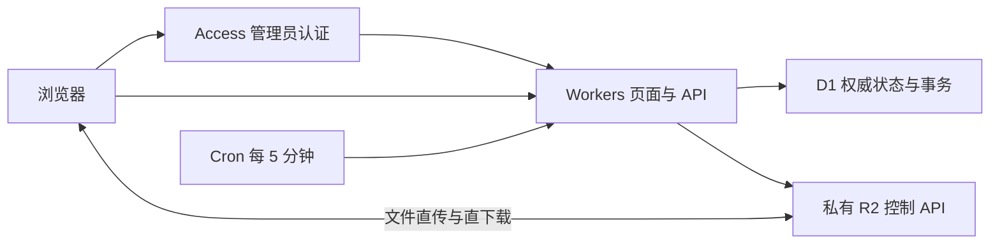

# V3：Workers + D1 + 私有 R2

V3 的页面和 API 由一个带 Static Assets 的 Worker 托管；D1 是分享、上传任务、下载会话和配额的唯一权威数据库。浏览器用 16 MiB Multipart 直接上传 R2，用短期签名 URL 直接下载。Cloudflare Access 认证管理员，Worker 验证 Access JWT、白名单、Origin 和 CSRF。树莓派、Go、SQLite、Tunnel 和内部 Origin 服务令牌退出这条请求链路。Go 部署模式继续保留；正式实例已切换 V3，线上验收与切换记录见 [V3 计划](v3-plan.md)。



## 构建和验证

需要 Node 24。首次构建安装两个子项目的锁定依赖，后续可使用 `--skip-install`。

```bash
./scripts/build-v3.sh
npm --prefix cloudflare run test:v3
npm --prefix cloudflare run test:browser:v3
WRANGLER_SEND_METRICS=false node cloudflare/node_modules/wrangler/bin/wrangler.js deploy --dry-run --config wrangler.json
python3 -m unittest discover -s scripts/tests -p test_export_v3.py -v
```

前端构建在 `dist/v3-web/`；测试 Worker bundle 在 `dist/v3/`。不会覆盖 Go 内嵌的 `web/dist/` 或 Pages 产物。V3 测试运行真正的 workerd、D1 与 R2 bindings，S3 ListParts 接口和浏览器跨域传输用测试适配层连接到本地 R2；这些测试不能替代线上 R2 签名、CORS、Access 登录和 CPU 预算验收。

也可以先独立验证真实 R2 S3 签名，无需部署 Worker 或提供账户管理 Token：

```bash
npm run test:v3:r2-live -- --live \
  --endpoint https://ACCOUNT_ID.r2.cloudflarestorage.com --bucket BUCKET \
  --credentials-file .parcel-v3/cloudflare-credentials.json \
  --result .parcel-v3/r2-probe-result.json
```

需要先安装 `cloudflare/` 依赖。凭据文件须为 0600，支持部署用 JSON 或 Go 的 R2 凭据格式；也可省略文件参数，使用两个 R2 环境变量。工具在随机 `parcel/v3/probes/` 对象上验证 16 MiB + 3 字节上传、错误大小拒绝、ListParts、完成、中文文件名下载及 SHA-256，并在 `finally` 中终止 Multipart、删除对象和检查 HEAD 404。结果文件必须不存在，内容不含凭据或签名 URL。若清理失败，按输出的临时对象键清理遗留对象与 Multipart。这项测试使用 S3 API，不验证 Worker native binding、浏览器 CORS、Access 或 CPU。

## 一次性账户准备

账户须已启用 R2、建立 Zero Trust 组织及 Workers 子域名。V3 默认支持 Workers Free，不需要订阅 Workers Paid。密码保护仍使用与 Go 一样的 Argon2id：32 MiB、2 次迭代、并行度 1；浏览器在独立 Web Worker 中计算，Cloudflare Worker 只执行原生 Web Crypto 加密和校验。Free 每次 HTTP 请求和 Cron 的 CPU 预算为 10 ms，生产环境仍须验证请求表现，不能用本地墙钟耗时代替 CPU 数据。[Workers 限制](https://developers.cloudflare.com/workers/platform/limits/)

密码接口协商 `client-argon2id-v1` 协议。创建与修改密码使用随机 16 字节盐，解锁使用公开的同一盐与固定参数，提交派生结果而非明文密码。D1 中的派生结果以 AES-GCM 加密，密钥由 `SESSION_SECRET` 单独域派生；KDF 参数和盐也经过认证。数据库记录无法直接作为解锁凭据重放。派生结果在传输中具有凭据性质，必须全程 HTTPS，禁止记录请求正文、在浏览器持久存储派生结果或把密码放入 URL。管理员授权、限流、版本失效与下载会话计数仍由服务端执行。Go 模式继续使用原明文密码接口。

`SESSION_SECRET` 同时保护会话与加密密码记录，必须长期保存并单独加密备份。丢失或直接替换会导致现有密码分享无法解锁；轮换前必须用旧密钥完成受控重新加密。将存储的密码哈希额外加密、密钥独立于数据库保存，符合密码存储加密的设计原则，但这里不声称整套应用获得标准认证。[NIST 密码存储指导](https://pages.nist.gov/800-63-4/sp800-63b.html)

准备一个仅限目标账户的管理 API Token，权限包括 Workers Scripts Edit、D1 Edit、Workers R2 Storage Write、Access Apps and Policies Write、Access Organizations Read、Access Identity Providers Read/Write；若控制台要求读取权限，补上对应 Read。R2 S3 Token 使用目标桶的 Object Read & Write。管理 Token 与 S3 Token 分开，不能把前者当作后者。

从 [deploy/v3.example.json](../deploy/v3.example.json) 复制配置到忽略目录 `.parcel-v3/deploy.json`，填写账户 ID 和管理员邮箱。`workersPaid:false` 为 Free 默认值；只有已订阅 Paid 的账户才设为 `true`，届时工具会增加 30 秒 CPU 上限和较大的清理批次。工具不会开通或更改套餐。默认创建隔离的 `parcel-v3` Worker、D1 和桶，并保持维护模式。新桶可以通过账户管理 Token 自动创建；S3 凭据须能访问指定桶。只有管理 Token 时，首次命令先创建隔离资源，保存可恢复的状态后停止；此时可在 Dashboard 为刚创建的桶生成限定桶的 S3 Token，填写凭据，再执行同一条命令完成部署。不会为避免这一步而要求覆盖所有桶的 S3 权限。已有 D1 须匹配保存的数据库 ID，或明确设置 `allowExistingDatabase:true` 后复用。已有桶必须明确设置 `allowExistingBucket:true`，并保证没有另一套后端正在写入/清理其中的相同对象。

通过本机环境或受保护的 CI Secrets 提供：

- `CLOUDFLARE_API_TOKEN`：账户管理 Token。
- `R2_ACCESS_KEY_ID`、`R2_SECRET_ACCESS_KEY`：目标桶的 S3 凭据。
- `SESSION_SECRET`：可选的 64 位十六进制密钥。本机首次部署自动生成并保存；CI 必须配置长期不变的值。

本机也可把这四项填写到 `.parcel-v3/cloudflare-credentials.json`（0600，忽略提交）；部署工具直接解析 JSON，不执行 shell 内容。环境变量优先于此文件。不要把真实值写在命令行参数、Git 文件或聊天中。部署状态及 Secret 保存到 `.parcel-v3/<name>/`，目录权限 0700，文件权限 0600。该目录必须备份，尤其是 `secrets.json` 中的会话和密码记录加密密钥。

## 单条部署命令

```bash
npm run deploy -- --config .parcel-v3/deploy.json --plan
npm run deploy -- --config .parcel-v3/deploy.json
```

`--plan` 只显示计划，完全不访问账户、不创建资源。实际命令先构建，然后复用/创建 D1 和私有 R2，合并专属 CORS 及 Multipart 终止规则，建立独立的管理员 Access 应用，应用数据库迁移，部署维护模式 Worker，通过标准输入上传 Secrets，最后进行公共 API 探测。中断后执行同一条命令可继续；已有无关 R2 规则保留。已有同名 Access 应用必须匹配保存的资源 ID，状态丢失时可把审阅过的 `accessAppId` 写入部署配置。默认不迁移旧域名，不覆盖原 Pages 或 Origin。

管理员 Access 应用覆盖 `/login`、`/admin`、`/admin/*`、`/api/v1/auth/*`、`/api/v1/admin/*`、`/api/v1/uploads`、`/api/v1/uploads/*`，仅允许配置邮箱。分享 `/s/*`、公共分享 API 和静态资源保持可访问。无身份提供商时创建邮件一次性验证码提供商，已有提供商保持原样。[Access API](https://developers.cloudflare.com/api/resources/zero_trust/subresources/access/subresources/applications/methods/create/)

首次使用独立桶、不迁移旧分享，可以在验证配置后激活：

```bash
npm run deploy -- --config .parcel-v3/deploy.json --activate
```

上线验收需通过管理员 Access 登录，上传 0 字节、小文件和超过 16 MiB 的文件，暂停/续传、密码解锁、下载续签和撤销；确认 Network 中没有 Pi/Origin 请求，文件内容只在浏览器与 R2 之间传输。查看 Workers 实际 CPU、异常及 Cron 执行记录，并确认重试和配额恢复。自动公共探测只证明公开 API 的配置与维护状态，不能证明这整套线上业务验收已完成。

## 迁移现有 Go 的 R2 分享

建议先用隔离桶验收 V3，再单独安排旧分享迁移。使用同一个桶迁移时，两套数据库不能同时写入或清理同一对象。D1 导入保留分享 ID、原密码的 Argon2id 盐与结果、授权版本、下载次数、下载会话和签名保留期；导入时将原 Go 哈希封装为加密记录，回滚导出时用同一密钥恢复 Go 格式。不复制文件内容。Go 的管理员会话不迁移，管理员在新 Access 应用重新登录。

1. 先在旧 Go 完成或取消所有在途上传，让旧单 PUT 签名过期、暂存对象清理完成。导出会拒绝未完成任务、活跃旧 PUT、未清理暂存对象及本地文件分享。
2. 将 V3 配置指向原 R2 桶，设置 `allowExistingBucket:true`、`active:false`，部署维护模式 Worker。保留原桶 CORS 来源，加入 V3 来源；保留当前旧域名，直到验证完毕。
3. 停止旧 Go 服务和清理进程，保持停止。对原数据库执行导出或用 SQLite backup 取得一致副本。工具同时检查 Go 数据目录 `.lock`，运行中的 Go 会使直接导出失败。保存原 `/etc/parcel/`、SQLite、二进制和部署配置。
4. 导出和导入（生成的配置路径由 Worker 名决定）：

```bash
python3 scripts/export-v3.py /path/to/parcel.db .parcel-v3/go-snapshot.json --bucket EXISTING_BUCKET --writers-frozen
node scripts/import-v3.mjs .parcel-v3/go-snapshot.json .parcel-v3/parcel-v3/wrangler.json --writers-frozen
```

目标 D1 必须空白或属于同一份快照。每批写入可恢复；全部内容、数量和配额验证后才标记导入完成。导入期间 Worker 保持维护。若目标 Worker 曾激活过，应先维护并等待 16 分钟，使旧请求与 Cron 完成，再导入。不要在正在服务的 D1 上导入。旧上传的幂等键仍保留，但重建请求缺少明文密码指纹时会拒绝旧键重用；新上传使用新键。

5. 原 Go 继续停机，激活独立 V3 地址并验收旧分享、密码和已有下载会话。只有 D1 成为唯一写入/清理者后才切换正式域名。域名变更须更新 `PUBLIC_URL`、Access destinations、R2 CORS 和前端访问入口；目前工具刻意只部署隔离 workers.dev 地址，正式域名切换是另一次可审阅的操作。

## 正式域名切换

先完成隔离环境验收，再转移正式域名。若需要保留旧分享，必须先执行上述冻结与迁移步骤；使用独立新桶切换时，旧分享不会自动出现在 V3，旧后端仍只管理旧桶。

1. 准备正式 Wrangler 配置：复用已验证的 Worker、D1、私有 R2 与 Secrets；把 `PUBLIC_URL` 改为正式 HTTPS 地址，把 `ACCESS_AUD` 改为覆盖正式域名管理员路径的 Access 应用 AUD，设置 `workers_dev:false`、`preview_urls:false`。先审阅应用的七个 destinations 与管理员邮箱策略，不能只替换地址而继续使用隔离环境 AUD。R2 CORS 加入正式来源，同时保留旧来源与无关规则。
2. 在 Dashboard 的原 Pages 项目 → 自定义域，解除正式域名绑定；然后在 V3 Worker → 设置 → 域和路由 → 添加 → 自定义域，填写同一域名。若旧 Pages CNAME 阻止绑定，只移除该主机名的旧记录，再由 Worker 创建记录。保留 Origin 域名与其他 DNS。这两个界面之间可能短暂中断，因此应在配置和回滚方案准备好后操作。
3. 部署已审阅的正式配置。通过 Dashboard 管理自定义域时，配置可以省略 `routes`；Wrangler 在没有 custom-domain routes 时不会重写已绑定的自定义域。由 CLI 创建/修改自定义域则还需要该 Zone 的 Workers Routes Write 权限。[Workers 权限](https://developers.cloudflare.com/workers/authorization/workers/)
4. 验证正式域名的未登录管理路径进入 Access，公共分享保持可访问，管理员登录、分块上传、密码、下载续签、撤销、Cron 和实际 CPU 均通过。确认 `workers.dev` 已关闭，再记录切换时间与资源配置。此时才把正式切换标为完成。

若切换验收失败，应先恢复 Worker 的隔离配置，再按需要恢复 Pages 自定义域。独立桶模式保留两套各自状态；同桶迁移必须使用冻结回滚快照，禁止让两套后端同时写入或清理同一对象。不要在正式切换后直接重跑只支持隔离地址的首次部署命令；它会恢复隔离配置并先进入维护。

## 回滚

若 V3 尚未激活、没有任何新状态写入，可以保持 V3 维护，再恢复原 Go 的一致备份与原域名。

V3 激活后，不能直接恢复旧 SQLite：这样会丢掉新增分享、下载次数、撤销和清理结果。先完成/取消 V3 在途上传，将部署配置 `active:false` 后重新部署，等待 16 分钟，使先前请求与最长 15 分钟 Cron 完成。`MAINTENANCE_SINCE` 和远程维护状态会被导出工具核对；若仍有未完成任务或未过期租约，拒绝回滚快照。

```bash
npm run deploy -- --config .parcel-v3/deploy.json
node scripts/export-d1-v3.mjs .parcel-v3/parcel-v3/wrangler.json .parcel-v3/d1-rollback.json
python3 scripts/rollback-v3.py .parcel-v3/d1-rollback.json /path/to/parcel.db --bucket EXISTING_BUCKET --writers-frozen
```

D1 回滚导出必须提供原 `SESSION_SECRET`；工具优先读取环境变量，然后读取本机凭据和已保存的部署 Secret。导出的快照包含 Go 格式密码哈希，应作为敏感备份保护。回滚工具拒绝直接写入未解密的 V3 密码记录。

Go 必须停机。回滚工具取得 Go `.lock`，自动保留 SQLite backup，在一个事务中恢复最新的四张权威状态表，保留 Go 管理员配置、现有 R2 对象键与已消费下载次数。确认 Go 的 R2 配置、正式 URL 和旧 Access/Gateway 仍匹配，再恢复域名和 Go 服务。V3 保持维护，避免两套清理器同时工作。

## 清理、备份和容量

Cron 每 5 分钟恢复未完成发布、处理闲置任务、清理过期/撤销/下载次数耗尽的分享。Free 默认每次最多处理一个上传任务和一个分享，过期会话、授权和审计各表每次删除最多 100 条。积压会留待后续执行，对象删除确认前继续计入配额。Paid 可配置 `CLEANUP_BATCH_SIZE` 为 1–30，Free 固定为 1，避免一次 Cron 扫描与清理过多。默认分享最长 7 天、下载会话最长 8 小时、签名 URL 5 分钟。对象至少保留到 `signed_until`，远程删除确认后才释放 D1 配额。没有 URL 即时撤销能力，已签发 URL 在短有效期内仍可能可用。[R2 预签名 URL](https://developers.cloudflare.com/r2/api/s3/presigned-urls/)

配额默认 20 GiB、单文件默认 8 GiB；只是应用保护额度，不是 Cloudflare 账单硬上限。R2 Standard 的免费存储额度为账户共享的 10 GB-month，还受操作次数额度约束；如希望减少超额风险，可把 `STORAGE_QUOTA_BYTES` 调低并预留旧桶、未完成 Multipart 和清理积压空间。Workers Free 不代表 R2 无限制免费。[R2 价格](https://developers.cloudflare.com/r2/pricing/)

所有状态事务走 D1 主库，下载计数及容量预留不依赖 KV 或只读副本。`batch()` 的事务和 SQL 触发器使计数、授权和额度一起提交。[D1 API](https://developers.cloudflare.com/d1/worker-api/d1-database/)

R2 生命周期规则只终止遗留的未完成 `parcel/v3/` Multipart，不按对象年龄删除已发布文件，避免绕过会话保留期。长时间持续上传仍须在该生命周期截止前完成；默认任务与规则时间窗口约一天。应用 Cron 和生命周期不能保证立刻回收空间，应监测失败任务和实际桶容量。

定期执行 D1 远程导出备份（无需维护，但仅作数据库备份；业务切换仍用冻结快照）：

```bash
node cloudflare/node_modules/wrangler/bin/wrangler.js d1 export DB --remote --config .parcel-v3/parcel-v3/wrangler.json --output .parcel-v3/backup.sql
```

D1 快照不是 R2 文件备份；对象删除与数据库恢复必须一起考虑。保留对象备份或明确可接受的临时文件丢失窗口。审计元数据保留 30 天，过期会话/授权/限流计数由 Cron 清理。部署状态和 Secrets 另行加密备份。

## CI 与正式开源

普通 CI 运行 V3 构建、Wrangler dry-run、workerd/D1/R2、迁移和浏览器测试。`Deploy V3 staging Worker` 工作流只通过手动触发部署，使用 GitHub `v3` Environment 的 `PARCEL_V3_CONFIG` JSON 变量及上述四个 Secrets（会话密钥名为 `PARCEL_V3_SESSION_SECRET`，S3 凭据名为 `PARCEL_V3_R2_ACCESS_KEY_ID`、`PARCEL_V3_R2_SECRET_ACCESS_KEY`）。资源 ID 缓存只含非 Secret 状态；设置 Environment 分支限制和审批以控制真正部署。

当前 V3 分支用于实现和验收，不改变仓库可见性，不发布 Release，不创建正式开源 Deploy 按钮。准备正式开源时再决定许可证、公开仓库、模板与发布版本。Cloudflare Deploy 按钮可自动准备 D1/R2，但 Access 和账单前置条件须在可公开模板中明确说明。[Deploy 按钮](https://developers.cloudflare.com/workers/platform/deploy-buttons/)
