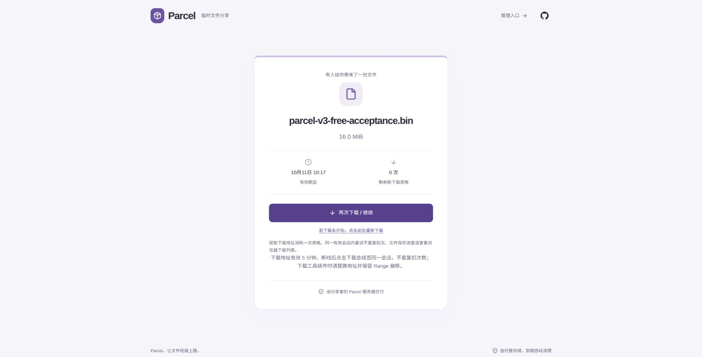
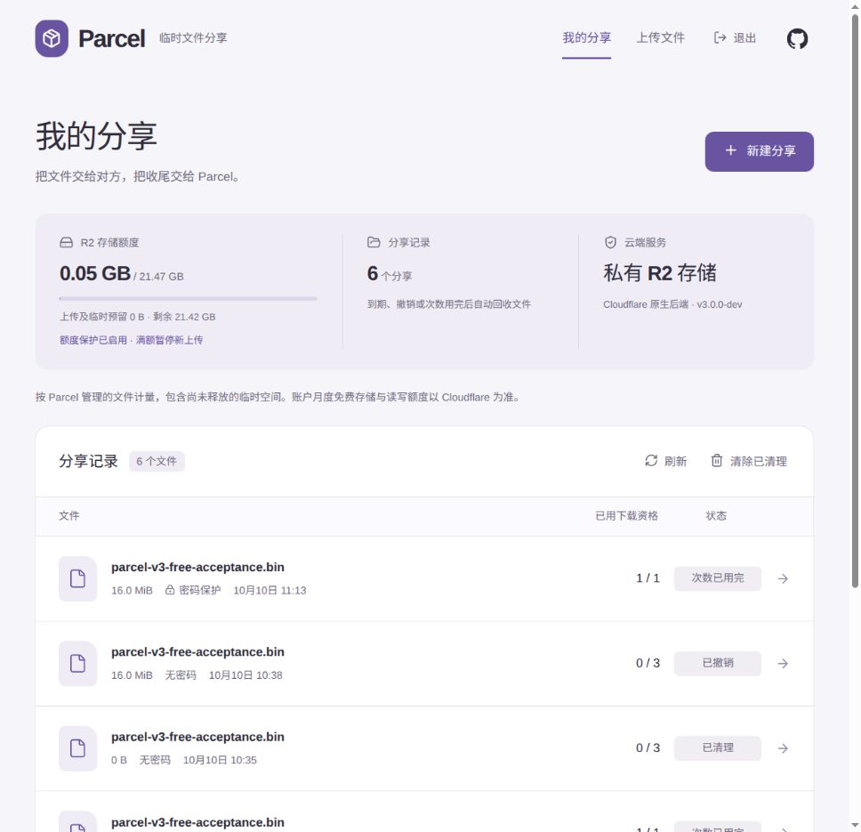

# V3：Cloudflare 原生后端

当前正式地址已切换到 V3，代码位于 `v3/serverless` 分支，正式开源发布另行决定。Workers 承担 API 和 Access 身份验证，D1 是唯一权威状态源，R2 保持私有、16 MiB Multipart 和浏览器直传/直下载。新模式不依赖树莓派、Tunnel 或内部 Origin 服务令牌。原 Go 模式代码继续保留；旧实例服务已停用、旧 R2 桶已删除。

## 完成条件

- [x] 完整兼容管理、上传、密码解锁、分享、下载会话、撤销及历史管理 API。
- [x] D1 原子下载计数、配额预留、幂等创建、授权版本校验，不使用 KV 做精确计数。
- [x] R2 服务端确认分块、大小与不可变任务元数据；完成失败可恢复，取消终止 Multipart。
- [x] 持久化任务租约、后台恢复、Cron 清理和签名 URL/下载会话保留期；删除确认后释放配额。
- [x] 默认拒绝未配置服务、未知路由、伪造 Access 身份和跨域写请求；强密码哈希与全局敏感操作限流。
- [x] 单条部署工具（实现及本地验证）：可重复资源创建、数据库迁移、R2 CORS/生命周期、Secret 配置、打包与验收；提供 CI 部署入口。
- [x] 导出/导入 Go SQLite 的 R2 分享元数据，切换前检查写入冻结、在途上传和保留期；保证只有一套后端写入/清理同一对象。
- [x] Miniflare/workerd 真正的 D1/R2 测试、浏览器闭环、并发与崩溃恢复测试、Go 兼容回归通过。
- [x] 完成部署、备份、切换、回滚和资源预算文档。
- [x] 使用已配置的账户管理 Token 与 S3 凭据，在 Workers Free 上部署隔离 V3 环境并验收 CPU、Access、签名/CORS、Cron。
- [x] 验收隔离环境后切换正式域名；正式开源发布仍另行决定。

## 已核实的平台约束

D1 `batch()` 提供事务；不使用 Sessions API 时查询走主库。安全关键查询保持主库语义。[D1 API](https://developers.cloudflare.com/d1/worker-api/d1-database/)

Cloudflare Deploy 按钮支持自动准备 D1/R2，迁移可放入部署脚本；子目录模板必须完全独立，当前仓库使用根目录构建入口。[Deploy 按钮](https://developers.cloudflare.com/workers/platform/deploy-buttons/)

Workers 目前默认限制单次 PBKDF2 为 100,000 次，提高到一百万的提案尚未合并；不能把本地 workerd 成功当作生产支持高迭代 PBKDF2 的证据。V3 不因此降低既有密码保护，继续使用 Argon2id。Free 模式已将固定参数的计算移到浏览器 Web Worker，服务端通过加密保存的派生结果校验；实际 Free 环境的验收结果见下文。[平台实现提案](https://github.com/cloudflare/workerd/pull/7550)、[Workers 限制](https://developers.cloudflare.com/workers/platform/limits/)

## 本地验收记录（2026-10-10）

- V3 workerd、D1/R2、部署工具、迁移和授权/过期竞态：25 项通过。
- Chromium、Firefox、手机尺寸上传/解锁/下载续签/撤销：3 项通过；两块实际大小为 16 MiB + 3 字节。
- Python 全套迁移/回滚/更新器测试：25 项通过，其中 V3 6 项；Go `go test -race ./...` 与 `go vet ./...` 通过。
- 原 Pages 11 项网关测试、workerd runtime、真实 Go Origin integration 和两个浏览器测试通过。
- 两套前端构建、V3 bundle 和 Wrangler dry-run 已验证；[V3 发布界面](previews/v3-published.png) 来自本地浏览器测试。
- GitHub 两次完整 CI 通过，包含原模式 117 项浏览器回归（3 项条件跳过）以及上述 V3 验收。
- 使用现有桶完成真实 S3 验证：V3 签名器上传 16 MiB + 3 字节，错误 Content-Length 返回 403 SignatureDoesNotMatch，ListParts 正确确认大小与 ETag，完成后的签名下载保留中文文件名、no-store 且 SHA-256 一致。临时 Multipart 和对象已清理，HEAD 为 404。这验证 S3 签名与解析；新桶 CORS、生产 Worker native binding、Access、CPU 与 Cron 仍待部署验证。
- 账户管理 Token 与目标桶 S3 凭据保存在本机忽略目录。以下单独记录 Cloudflare 线上验收和后续正式域名切换。

## Workers Free 验收（2026-10-10）

浏览器 Web Worker 使用固定的 Argon2id 参数计算派生结果；服务端使用 Web Crypto 加密保存和校验。新增测试覆盖 Go 已知向量、密文篡改/错误密钥/数据库记录重放拒绝、加密迁移的幂等恢复、Go 回滚哈希还原、空密码变更拒绝和 Free 单项 Cron 清理。三种浏览器验证了创建与解锁发送相同派生结果，网络请求和浏览器持久存储中没有明文密码，持久存储中没有派生密钥。

真实 Free 账户的临时探测 Worker 连续 20 次完成加密、正确/错误派生结果校验、CSRF HMAC 和 D1 查询，全部 HTTP 200，无 CPU 超限响应；原生 R2 put/head/delete 也通过。该探测不使用完整业务路由，不能替代管理员 Access 登录和业务请求的线上验收，也未取得 CPU 指标。临时 Worker 已删除，未开通付费套餐。独立 V3 桶的真实 S3 上传、ListParts、完成和 SHA-256 下载校验通过，临时对象清理后 HEAD 404。

隔离环境先在 Workers Free 部署并激活，用独立 D1 和私有 R2 桶完成以下验收；管理员 Access 仅允许配置邮箱，未开通 Paid。随后切换到[正式实例](https://parcel.playereconlab.com)，关闭隔离 workers.dev 地址。

- Chrome 实际通过 Access 登录；浏览器直传 16 MiB + 3 字节，R2 ETag 确认两块 Multipart，D1 保存加密密码记录。错误密码被拒绝，正确密码解锁；两次实际下载的 SHA-256 都与本机合成文件一致，续签后计数仍是 1/1。撤销后分享立即失效，已有签名的对象按会话保留期等待清理。
- 另一份 16 MiB + 3 字节文件在真实上传中暂停，界面显示暂停状态；恢复后完成发布。
- 零字节文件实际上传、发布和下载通过。20 个线上并发请求争抢最后一次资格：1 个 201、19 个 410。触发每分钟限流后，下一窗口续签 200，D1 计数仍为 1。
- 两轮共 68 条真实 HTTP/每五分钟 Cron 观察记录均为 `outcome:ok`，未观察到 CPU 超限错误。签名密钥增加 isolate 内缓存后，实际采样仍有 13–16 ms 的成功请求；Free 标称 CPU 预算是 10 ms，Cloudflare 会有短暂弹性，当前验收不能保证冷启动、大文件 ListParts 或未来每次请求都不超预算。应观察 Worker Errors/CPU，若出现 1102，应继续拆分对应操作或评估 Paid。
- 临时 Free ListParts 探测覆盖 64、512 和 1000 项 XML，均 HTTP 200；这是解析/签名路径的合成压力测试，不代表实际上传了 8 GiB 文件。所有临时探测 Worker 均已删除。

## 正式域名切换（2026-10-10）

用户授权后，通过 Dashboard 将 `parcel.playereconlab.com` 绑定到 `parcel-v3` Worker；旧 Pages 项目已经没有自定义域。部署正式配置后，远程 API 核实正式 `PUBLIC_URL`、对应管理员 Access AUD、独立 D1/R2 与 Free 设置，关闭 workers.dev 和预览地址。正式 Access 七个管理路径及邮箱策略复用已审阅的原应用，R2 CORS 保留隔离来源并加入正式来源。

未登录 `/admin` 与管理 API 返回 302 到 Access，公共页面 200、未知分享 404，隔离 workers.dev 返回 404。Chrome 在正式域名通过既有 Access 登录，管理面板显示 Cloudflare 原生后端。切换当时原 Go、SQLite、配置及旧桶保留；随后按用户要求停用旧服务并删除空的旧桶 `parcel`，SQLite 与配置继续保留。V3 独立桶由 D1 唯一管理，旧模式不会写入新桶。正式开源、合并和发布 Release 仍另行决定。

正式域名重新完成 16 MiB + 3 字节密码保护 Multipart 上传，错误密码拒绝、正确密码解锁，两次真实下载的 SHA-256 与原文件一致，续签后 D1 计数保持 1/1。未授权请求无法获得文件名。正式配置下的实际 Cron 为 `outcome:ok`，CPU 3 ms、无异常；撤销测试分享立即失效，未签发会话的对象进入后台清理流程。

